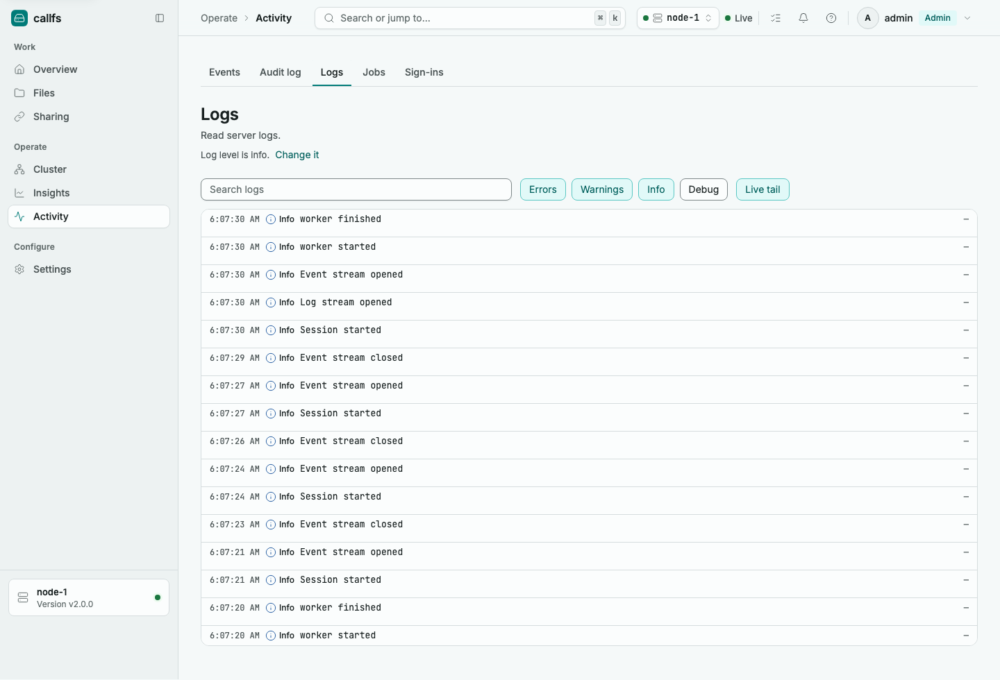
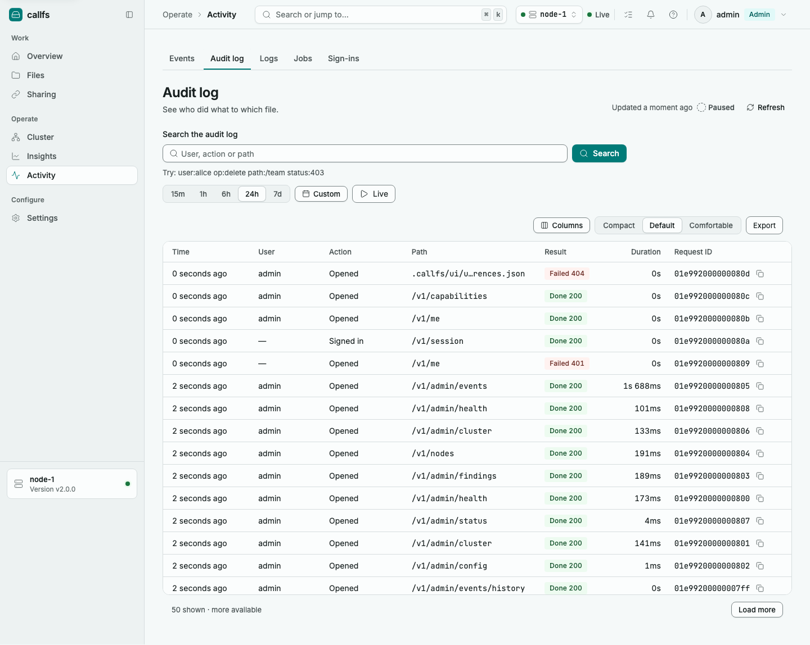
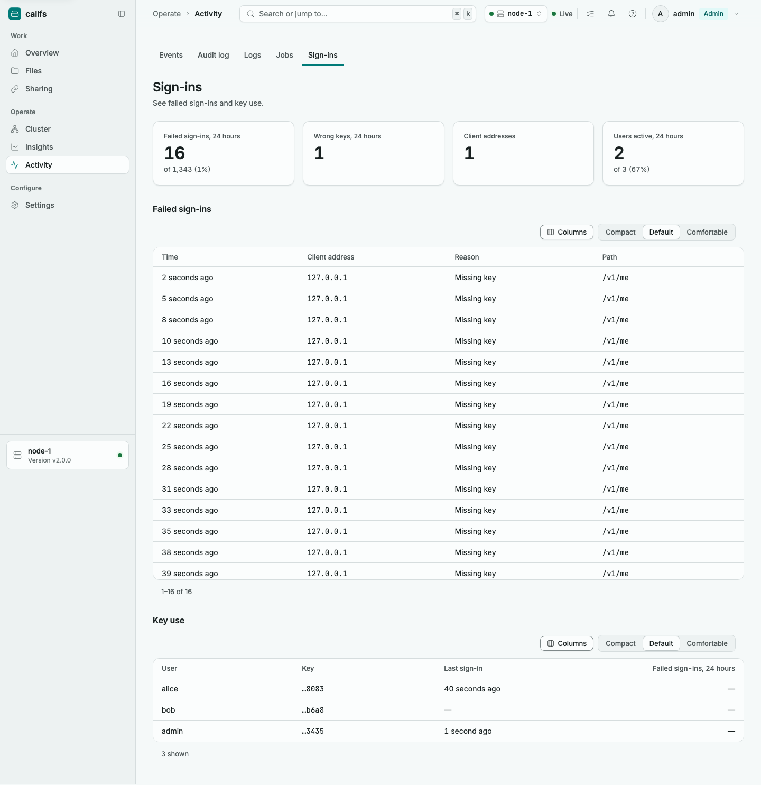
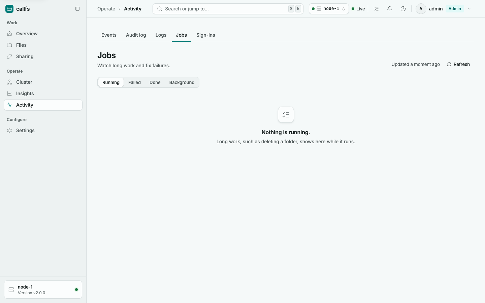
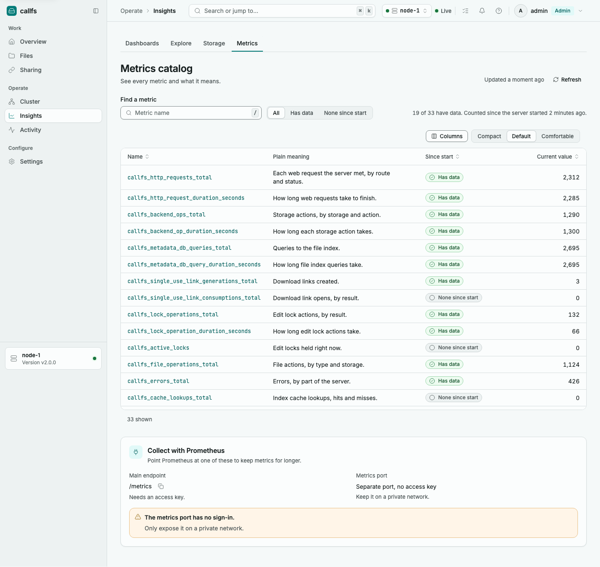

# Monitoring and Metrics

CallFS gives you four ways to see what it is doing:

- Prometheus metrics for graphs and alerts.
- Health endpoints for load balancers and orchestrators.
- Health findings, a list of problems and risks CallFS finds in its own setup.
- Logs, audit records, sign-in history and background jobs, in the web console and the admin API.

Related pages: [Configuration](02-configuration.md), [Authentication and security](04-authentication-security.md), [Clustering](07-clustering.md), [Troubleshooting](09-troubleshooting.md), [Admin API](10-admin-api.md).

## Contents

1. [Metrics endpoints](#metrics-endpoints)
2. [Metric reference](#metric-reference)
3. [PromQL examples](#promql-examples)
4. [Alert rules](#alert-rules)
5. [Grafana tips](#grafana-tips)
6. [Profiling](#profiling)
7. [Health endpoints](#health-endpoints)
8. [Health findings](#health-findings)
9. [Logs](#logs)
10. [Audit log](#audit-log)
11. [Sign-in history](#sign-in-history)
12. [Events](#events)
13. [Background jobs and workers](#background-jobs-and-workers)
14. [Console charts and the metrics catalog](#console-charts-and-the-metrics-catalog)

## Metrics endpoints

CallFS serves Prometheus text format on `/metrics` in two places.

| Endpoint | Auth | Use it for |
|---|---|---|
| `http(s)://files.example.com:8443/metrics` (main port) | Required: an API key as `Authorization: Bearer your-api-key`, or a console session | Scraping through the same address as the API |
| `http://10.0.0.5:9090/metrics` (metrics port) | None | Scraping from a private monitoring network |

The metrics port is a separate listener. It is set by `metrics.listen_addr`.

| Key | Type | Default | Allowed | Restart needed |
|---|---|---|---|---|
| `metrics.listen_addr` | host:port | `:9090` | Any `host:port`. Empty turns the metrics port off. | Yes |
| `metrics.profiling` | bool | `false` | `true`, `false` | Yes |

Environment variables: `CALLFS_METRICS__LISTEN_ADDR`, `CALLFS_METRICS__PROFILING`.

```yaml
metrics:
  listen_addr: 10.0.0.5:9090
  profiling: false
```

The metrics port has no sign-in. Anyone who can reach it can read every metric. Bind it to a private address (`127.0.0.1:9090` or a private interface), or put a firewall in front of it. If you set a non-loopback address, the health finding `metrics.public_port` appears as a reminder.

Quick checks:

```bash
curl -s http://10.0.0.5:9090/metrics | head
curl -s -H "Authorization: Bearer your-api-key" https://files.example.com:8443/metrics | head
```

Prometheus scrape config for the metrics port:

```yaml
scrape_configs:
  - job_name: callfs
    scrape_interval: 15s
    static_configs:
      - targets: ["node-1.example.com:9090", "node-2.example.com:9090"]
```

Prometheus scrape config for the main port with an API key:

```yaml
scrape_configs:
  - job_name: callfs
    scheme: https
    authorization:
      type: Bearer
      credentials: your-api-key
    static_configs:
      - targets: ["files.example.com:8443"]
```

Counters count from the moment the server starts. In a cluster, scrape every node and sum or group by the `instance` label Prometheus adds.

## Metric reference

All names start with `callfs_`. Histograms use the default Prometheus buckets: 0.005, 0.01, 0.025, 0.05, 0.1, 0.25, 0.5, 1, 2.5, 5, 10 seconds. Each histogram also exposes `_bucket`, `_sum` and `_count` series.

### HTTP requests and errors

| Metric | Type | Labels | Meaning |
|---|---|---|---|
| `callfs_http_requests_total` | counter | `method`, `path`, `status_code` | Requests served. `path` is the route pattern (for example `/v1/files/*`), never the real file path. Requests that match no route use `unmatched`. `method` is one of GET, HEAD, POST, PUT, PATCH, DELETE, OPTIONS, or `OTHER`. |
| `callfs_http_request_duration_seconds` | histogram | `method`, `path` | Time to serve a request. Live streams and WebSocket upgrades are not timed. |
| `callfs_errors_total` | counter | `component`, `error_type` | Responses with status 400 or above. `component` is the first part of the route (`files`, `links`, `admin`, `download`, `trash`, `uploads`, and so on, or `other`). `error_type` is a name for the status: `bad_request` (400), `unauthorized` (401), `forbidden` (403), `not_found` (404), `method_not_allowed` (405), `timeout` (408), `conflict` (409), `gone` (410), `precondition_failed` (412), `too_large` (413), `unsupported_media_type` (415), `bad_range` (416), `invalid` (422), `rate_limited` (429), `internal` (500), `not_implemented` (501), `bad_gateway` (502), `unavailable` (503), `gateway_timeout` (504), `insufficient_storage` (507). Other 4xx are `client_error`, other 5xx are `server_error`. |
| `callfs_rate_limit_rejections_total` | counter | `endpoint` | Requests rejected by a rate limit. `endpoint` is `download`, `link_generate` or `session`. |
| `callfs_auth_failures_total` | counter | `reason` | Failed authentications. `reason` is `missing_key`, `wrong_key`, `expired_session`, `csrf`, `blocked` (client blocked after repeated failures) or `bad_delegation` (invalid on-behalf-of user from a peer server). |
| `callfs_transfers_active` | gauge | `kind` | Transfers running now. `kind` is `upload`, `download` or `websocket`. |

### Files and storage

| Metric | Type | Labels | Meaning |
|---|---|---|---|
| `callfs_file_operations_total` | counter | `operation`, `backend_type` | File actions. `operation` is `create`, `read`, `update`, `delete` or `rename`. `backend_type` is `localfs`, `s3`, `internal_proxy` or `erasure`. |
| `callfs_backend_ops_total` | counter | `backend_type`, `operation` | Calls to a storage backend. `backend_type` is `localfs` or `s3`. `operation` is `open`, `open_range`, `create`, `update`, `delete`, `move`, `stat`, `list_directory`, `create_directory` or `close`. |
| `callfs_backend_op_duration_seconds` | histogram | `backend_type`, `operation` | Time of each storage call. Use it to find a slow disk or slow S3. |
| `callfs_backend_op_failures_total` | counter | `backend_type`, `operation` | Storage calls that returned an error. |
| `callfs_usage_bytes` | gauge | `storage` | Bytes stored per storage. Refreshed every 10 minutes and once at start. |
| `callfs_usage_files` | gauge | `storage` | Files stored per storage. Same refresh. |
| `callfs_replication_total` | counter | `result` | Backup copy attempts. `result` is `succeeded`, `failed`, `dropped` (the copy could not be queued) or `skipped` (the file was deleted or changed before its queued copy ran, or the copy target changed). |
| `callfs_overwrite_restores_total` | counter | none | Old file copies put back during startup recovery after a stop in the middle of an overwrite. |
| `callfs_erasure_pieces_repaired_total` | counter | none | Pieces of split (erasure coded) files rebuilt by repairs. |

### File index and cache

| Metric | Type | Labels | Meaning |
|---|---|---|---|
| `callfs_metadata_db_queries_total` | counter | `operation` | Calls to the file index. `operation` is one of `get`, `create`, `update`, `update_if_match`, `delete`, `rename`, `list_children`, `count_children`, `has_children`, `list_descendants`, `search_descendants`, `list_by_prefix`, `apply_batch`, `get_single_use_link`, `create_single_use_link`, `update_single_use_link`, `consume_single_use_link`, `count_active_single_use_links`, `cleanup_expired_links`, `cleanup_used_links`, `close`. |
| `callfs_metadata_db_query_duration_seconds` | histogram | `operation` | Time of each file index call. |
| `callfs_cache_lookups_total` | counter | `result` | File index cache lookups. `result` is `hit` or `miss`. |
| `callfs_cache_evictions_total` | counter | none | Entries pushed out of the cache. |
| `callfs_cache_entries` | gauge | none | Entries in the cache now. |

### Download links

| Metric | Type | Labels | Meaning |
|---|---|---|---|
| `callfs_single_use_link_generations_total` | counter | none | Single-use links created. |
| `callfs_single_use_link_consumptions_total` | counter | `status` | Link open attempts. `status` is `success`, `expired`, `invalid`, `not_found` or `error`. |
| `callfs_single_use_links_active` | gauge | none | Links that can still be opened. |

### Edit locks

| Metric | Type | Labels | Meaning |
|---|---|---|---|
| `callfs_lock_operations_total` | counter | `operation`, `status` | Lock actions. `operation=acquire` has `status` of `acquired`, `timeout`, `cancelled` or `error`. `release` has `ok` or `error`. `force_release` has `ok`. `renew` has `error`. `lease` has `lost` (a lock was lost before its holder finished). |
| `callfs_lock_operation_duration_seconds` | histogram | `operation` | Time spent on a lock action. For `acquire` this includes waiting for another holder. |
| `callfs_active_locks` | gauge | none | Locks held now. |

`GET /v1/admin/locks` (and Cluster, Edit locks in the console) also reports lock statistics since start: acquired, timeouts, cancelled, errors, lost, renew errors, and the wait time p50 and p95 in milliseconds. They are reported for every lock type, including NATS locks.

### Jobs

| Metric | Type | Labels | Meaning |
|---|---|---|---|
| `callfs_jobs_total` | counter | `kind`, `result` | Finished jobs. `kind` is the job kind (see [Background jobs](#background-jobs-and-workers)). `result` is `succeeded`, `partial`, `failed` or `cancelled`. |

### Embedded NATS (clustering)

These come from the embedded NATS server that carries cluster state. They refresh at most every 2 seconds.

| Metric | Type | Labels | Meaning |
|---|---|---|---|
| `callfs_nats_connected` | gauge | none | 1 when the embedded NATS server is running, 0 otherwise. |
| `callfs_nats_routes` | gauge | none | Connected cluster routes (links to the other nodes). |
| `callfs_nats_slow_consumers` | counter | none | Clients disconnected for being too slow, since start. |
| `callfs_nats_in_msgs` | counter | none | Messages received. |
| `callfs_nats_out_bytes` | counter | none | Bytes sent. |
| `callfs_nats_js_api_errors` | counter | none | Stream (JetStream) API requests that returned an error. |
| `callfs_nats_stream_messages` | gauge | `stream` | Messages stored in a stream. |
| `callfs_nats_stream_bytes` | gauge | `stream` | Bytes stored in a stream. |

### Removed series

The `callfs_raft_*` series do not exist in 2.0.0. Raft cluster mode was removed in 2.0.0; configs that use it are rejected at startup. Use `metadata_store.type: nats` and `dlm.type: nats`, and `callfs_nats_*` for cluster health.

Standard Go runtime and process metrics (`go_*`, `process_*`) are also exposed.

## PromQL examples

Requests per second, by status:

```promql
sum by (status_code) (rate(callfs_http_requests_total[5m]))
```

Share of requests that return 5xx:

```promql
sum(rate(callfs_http_requests_total{status_code=~"5.."}[5m]))
  / sum(rate(callfs_http_requests_total[5m]))
```

95th percentile response time per route:

```promql
histogram_quantile(0.95,
  sum by (le, path) (rate(callfs_http_request_duration_seconds_bucket[5m])))
```

Slowest 5% of storage calls, per backend and operation:

```promql
histogram_quantile(0.95,
  sum by (le, backend_type, operation) (rate(callfs_backend_op_duration_seconds_bucket[5m])))
```

Storage failure rate:

```promql
sum by (backend_type, operation) (rate(callfs_backend_op_failures_total[5m]))
```

Metadata cache hit ratio:

```promql
sum(rate(callfs_cache_lookups_total{result="hit"}[5m]))
  / sum(rate(callfs_cache_lookups_total[5m]))
```

Failed sign-ins per minute, by reason:

```promql
sum by (reason) (rate(callfs_auth_failures_total[5m])) * 60
```

Share of download link opens that fail:

```promql
1 - (
  sum(rate(callfs_single_use_link_consumptions_total{status="success"}[1h]))
  / sum(rate(callfs_single_use_link_consumptions_total[1h]))
)
```

Lock wait time, 95th percentile:

```promql
histogram_quantile(0.95,
  sum by (le) (rate(callfs_lock_operation_duration_seconds_bucket{operation="acquire"}[5m])))
```

Stored bytes per storage:

```promql
sum by (storage) (callfs_usage_bytes)
```

Cluster routes per node (a three-node cluster should show 2 on each):

```promql
callfs_nats_routes
```

## Alert rules

```yaml
groups:
  - name: callfs
    rules:
      - alert: CallFSDown
        expr: up{job="callfs"} == 0
        for: 2m
        labels: { severity: critical }
        annotations:
          summary: "{{ $labels.instance }} is not answering scrapes"

      - alert: CallFSHighErrorRate
        expr: |
          sum by (instance) (rate(callfs_http_requests_total{status_code=~"5.."}[5m]))
            / sum by (instance) (rate(callfs_http_requests_total[5m])) > 0.05
        for: 10m
        labels: { severity: warning }
        annotations:
          summary: "More than 5% of requests fail on {{ $labels.instance }}"

      - alert: CallFSSlowRequests
        expr: |
          histogram_quantile(0.95,
            sum by (le, instance) (rate(callfs_http_request_duration_seconds_bucket[5m]))) > 2
        for: 10m
        labels: { severity: warning }
        annotations:
          summary: "95th percentile response time is above 2 seconds on {{ $labels.instance }}"

      - alert: CallFSStorageFailures
        expr: sum by (instance, backend_type) (rate(callfs_backend_op_failures_total[5m])) > 0
        for: 5m
        labels: { severity: critical }
        annotations:
          summary: "{{ $labels.backend_type }} storage calls are failing on {{ $labels.instance }}"

      - alert: CallFSBackupCopiesFailing
        expr: increase(callfs_replication_total{result="failed"}[1h]) > 0
        labels: { severity: warning }
        annotations:
          summary: "Backup copies failed in the last hour on {{ $labels.instance }}"

      - alert: CallFSFailedSignInsSpike
        expr: sum by (instance) (increase(callfs_auth_failures_total[10m])) > 100
        labels: { severity: warning }
        annotations:
          summary: "More than 100 failed sign-ins in 10 minutes on {{ $labels.instance }}"

      - alert: CallFSLockTimeouts
        expr: increase(callfs_lock_operations_total{operation="acquire",status="timeout"}[10m]) > 0
        labels: { severity: warning }
        annotations:
          summary: "Edit lock requests are timing out on {{ $labels.instance }}"

      - alert: CallFSLostLocks
        expr: increase(callfs_lock_operations_total{operation="lease",status="lost"}[10m]) > 0
        labels: { severity: warning }
        annotations:
          summary: "Locks were lost before their holders finished on {{ $labels.instance }}"

      - alert: CallFSNATSDown
        expr: callfs_nats_connected == 0
        for: 1m
        labels: { severity: critical }
        annotations:
          summary: "Embedded NATS is not running on {{ $labels.instance }}"

      - alert: CallFSClusterRoutesLost
        expr: callfs_nats_routes < 2
        for: 2m
        labels: { severity: warning }
        annotations:
          summary: "{{ $labels.instance }} lost links to other nodes (set the number to nodes minus 1)"

      - alert: CallFSSlowConsumers
        expr: increase(callfs_nats_slow_consumers[10m]) > 0
        labels: { severity: warning }
        annotations:
          summary: "NATS is disconnecting slow clients on {{ $labels.instance }}"

      - alert: CallFSJobsFailing
        expr: increase(callfs_jobs_total{result="failed"}[1h]) > 0
        labels: { severity: warning }
        annotations:
          summary: "Jobs of kind {{ $labels.kind }} failed on {{ $labels.instance }}"
```

Adjust `callfs_nats_routes < 2` to your cluster size minus one. Remove the NATS alerts on a single node without clustering.

## Grafana tips

- Add Prometheus as a data source, then build panels from the queries above.
- Set the panel interval to at least twice your scrape interval so `rate()` always has two samples.
- Use `$__rate_interval` instead of a fixed `[5m]` in panel queries.
- Show latency as a heatmap using `sum by (le) (rate(callfs_http_request_duration_seconds_bucket[$__rate_interval]))` with the format set to Heatmap.
- Add a `instance` template variable (`label_values(callfs_http_requests_total, instance)`) to switch between nodes, and a `path` variable to focus on one route.
- Use `callfs_http_requests_total` and `callfs_errors_total` together: the first shows load, the second shows which part of the API (`component`) returns which error type.
- Stat panels for `callfs_active_locks`, `callfs_transfers_active` and `callfs_single_use_links_active` give a quick view of current activity.
- Use a stacked bar for `callfs_usage_bytes` by `storage` to see where data lives.
- If you do not run Grafana, the web console has its own dashboards. See [Console charts](#console-charts-and-the-metrics-catalog).

## Profiling

Set `metrics.profiling: true` to also serve Go profiles on the metrics port. It needs `metrics.listen_addr` to be set. Restart is required.

Profiling adds a little work to every lock and wait, so turn it on only while you investigate a problem.

| Path (on the metrics port) | What it returns |
|---|---|
| `/debug/pprof/` | Index of all profiles |
| `/debug/pprof/profile?seconds=30` | CPU profile |
| `/debug/pprof/heap` | Memory in use |
| `/debug/pprof/allocs` | Past memory allocations |
| `/debug/pprof/goroutine` | All running goroutines |
| `/debug/pprof/block` | Where code waits on locks and channels |
| `/debug/pprof/mutex` | Contention on mutexes |
| `/debug/pprof/threadcreate` | Thread creation |
| `/debug/pprof/trace?seconds=5` | Execution trace |
| `/debug/pprof/cmdline` | Command line of the process |
| `/debug/pprof/symbol` | Symbol lookup |

```bash
go tool pprof http://10.0.0.5:9090/debug/pprof/profile?seconds=30
go tool pprof http://10.0.0.5:9090/debug/pprof/heap
curl -o trace.out "http://10.0.0.5:9090/debug/pprof/trace?seconds=5"
```

The profiling paths have no sign-in, like the rest of the metrics port. Never expose them to an untrusted network. With profiling on, the metrics port has no write timeout so long profiles can finish; without it, responses time out after 30 seconds.

## Health endpoints

Both endpoints are on the main port and need no authentication.

### GET /health

A cheap liveness check. It returns `200` with a small JSON body whenever the process is up and answering.

```bash
curl -s https://files.example.com:8443/health
```

```json
{"status":"ok"}
```

The `healthcheck` command calls this endpoint on the local server and exits 0 for a `200` answer and non-zero otherwise. Use it as a container health check:

```bash
callfs healthcheck --config /etc/callfs/config.yaml
```

### GET /health/ready

A readiness check for this server only. It tests the parts this server needs to serve traffic. Results are cached for 2 seconds, so it is safe to call often. The body is `{"status":"..."}`.

| Overall status | HTTP code | Meaning |
|---|---|---|
| `ok` | 200 | Every component is ok or disabled |
| `degraded` | 200 | At least one component is in `warn`, nothing is down |
| `down` | 503 | At least one component is down |

Other servers never affect readiness. When a peer server does not answer, it is listed in a `peers` array next to `status`, for example:

```json
{"status":"ok","peers":[{"name":"storage.internal_proxy","status":"down","detail":"peer down"}]}
```

Peers are information only. They never turn the status to `degraded` or `down`, and they never return 503. `peers` is left out when there is nothing to list.

```bash
curl -s -o /dev/null -w "%{http_code}\n" https://files.example.com:8443/health/ready
```

Use `/health` for liveness (restart the process if it fails) and `/health/ready` for readiness (stop sending traffic if it returns 503).

### Components checked

Every check has a 2 second limit. A check that does not answer in time counts as `down` with the detail "No answer within 2 seconds".

| Component | Disabled when | Down when | Warn when |
|---|---|---|---|
| `file_index` | never | The file index cannot be read | never |
| `locks` | never | A test lock cannot be taken | The test lock cannot be released |
| `storage.localfs` | No `backend.localfs_root_path` | The local disk storage does not answer | never |
| `storage.s3` | No `backend.s3_bucket_name` | The S3 bucket does not answer | never |
| `storage.internal_proxy` | No peer servers are configured | A peer server does not answer (shown as a peer, never fails readiness) | never |
| `nats` | `nats.enabled` is false | This server is not connected to NATS | never |
| `metadata_log` | `nats.enabled` is false | The file index log is not ready, or this server is more than 5000 changes behind | This server is more than 100 changes behind, or some file index copies are offline |
| `erasure` | `erasure.enabled` is false | Erasure is on but split storage is not running | never |
| `tls` | `server.protocol` is `http`, or `auto` with no certificate | `https` with no certificate file, an unreadable file or an expired certificate | The certificate expires in under 21 days |
| `disk` | never | Less than 1% of the disk is free | Less than 10% is free, or the size is unknown |
| `replication` | `ha.replication_enabled` is false | never | Backup copies failed in the last hour |
| `link_cleanup` | never | never | The cleanup worker cannot report its last run |

### Detailed report for admins

Admins can read the per-component report with `GET /v1/admin/health` (add `?fresh=true` to skip the 5 second cache). Each component has `name`, `status` (`ok`, `warn`, `down`, `disabled`), `latency_ms`, `detail`, `since` (when the status last changed) and `informational` (true for peer entries that do not count toward the overall status).

```bash
curl -s -H "Authorization: Bearer your-admin-api-key" \
  "https://files.example.com:8443/v1/admin/health?fresh=true"
```

The console Home page shows the same information. See [Web console](08-web-console.md).

## Health findings

Findings are problems and risks CallFS spots in its own settings and state, such as a certificate that is about to expire or a default secret that is still in use. They are re-evaluated whenever you open the page and use live facts like free disk space and recent sign-in failures.

Where to see them:

- The Home page of the web console lists them with counts of critical, warning and info items.
- `GET /v1/admin/findings` returns them (admin only).

Each finding has an id, a severity, an area, a title, an explanation, the servers or items affected, the time it first appeared (`since`), and a fix (a link to the right console page and, when it applies, the setting key to change).

Severity:

| Severity | Meaning |
|---|---|
| `critical` | Fix now. Data, access or availability is at risk. |
| `warning` | Fix soon. |
| `info` | Good to know or to improve. |

Areas: `security`, `storage`, `cluster`, `config`, `runtime`. `nats.plain_transport` is listed under `security`.

### Muting and ignoring

| Action | Effect | Details |
|---|---|---|
| Mute | Hides the finding for a time. It comes back on its own. | Duration 60 seconds to 7 days (604800 seconds). The console offers 1 hour, 1 day and 7 days. You can add a reason of up to 200 characters. Unmute at any time. |
| Ignore | Stops the finding counting toward health, banners and alerts on every server, until you stop ignoring it. | Add a reason of up to 200 characters, for example "Internal network only". Choose "Stop ignoring" to bring it back. |

In the console, use "Mute for…" and "Ignore" on a finding. Muted and ignored findings can be shown with "Show muted findings" and "Show ignored findings". Both lists store who did it and why, and are shared by every server in the cluster.

```bash
curl -X POST -H "Authorization: Bearer your-admin-api-key" -H "Content-Type: application/json" \
  -d '{"duration_s":86400,"reason":"Fix scheduled for Friday"}' \
  https://files.example.com:8443/v1/admin/findings/disk.low/mute

curl -X DELETE -H "Authorization: Bearer your-admin-api-key" \
  https://files.example.com:8443/v1/admin/findings/disk.low/mute

curl -X POST -H "Authorization: Bearer your-admin-api-key" -H "Content-Type: application/json" \
  -d '{"reason":"Internal network only"}' \
  https://files.example.com:8443/v1/admin/findings/metrics.public_port/ignore

curl -X DELETE -H "Authorization: Bearer your-admin-api-key" \
  https://files.example.com:8443/v1/admin/findings/metrics.public_port/ignore
```

Muting or ignoring an unknown id, or a finding that is not active right now, returns an error. See the [Admin API](10-admin-api.md) for status codes.

### Finding reference

Security

| Id | Severity | Appears when | What to do |
|---|---|---|---|
| `tls.plain_http` | critical | `server.protocol` is `http`, or `auto` and CallFS fell back to plain HTTP | Set `server.protocol: https` with a certificate and key. |
| `tls.cert_unreadable` | critical | The certificate file cannot be read | Check `server.cert_file` and its permissions. |
| `tls.cert_expiring` | warning | The certificate expires within 21 days | Renew the certificate. |
| `tls.cert_expired` | critical | The certificate has expired | Install a new certificate now. |
| `tls.key_world_readable` | warning | The private key file can be read by every user on the machine | Limit the file to the server account (for example `chmod 600`). |
| `secret.default` | critical | `auth.internal_proxy_secret` or `auth.single_use_link_secret` still holds the example placeholder | Set a long random value. |
| `secret.short` | warning | One of those secrets is shorter than 32 characters | Use at least 32 random characters. |
| `secret.same` | warning | The link secret and the internal secret are identical | Give them different values. |
| `keys.positional` | warning | `auth.api_keys` is used (keys tied to a numbered user) | Move the keys to named users on the Users and keys page. |
| `metrics.public_port` | warning | `metrics.listen_addr` is set to a non-loopback address | Bind it to a private address, or ignore the finding if the network is private. |
| `peers.skip_verify` | critical | `backend.internal_proxy_skip_tls_verify` is true | Turn certificate checks back on. |
| `index.sslmode_disable` | warning | The Postgres file index uses `sslmode=disable` | Use `sslmode=require` or `verify-full` in `metadata_store.dsn`. |
| `index.default_password` | warning | The Postgres password in `metadata_store.dsn` is the example value | Set a unique password. |
| `redis.no_password` | warning | `metadata_store.type` or `dlm.type` is `redis` with no password | Set `metadata_store.redis_password` or `dlm.redis_password`. |
| `s3.public_acl` | critical | `backend.s3_acl` starts with `public-` | Set the bucket access to `private`. |
| `s3.no_encryption` | info | `backend.s3_server_side_encryption` is empty | Turn on server-side encryption. |
| `auth.failures_spike` | warning | More than 100 failed sign-ins in the last 10 minutes | Open Sign-ins and look for a bad key or an attack. |
| `admin.none` | info | `auth.admin_users` is empty | Add an admin user so the root account is not the only manager. |

Cluster

| Id | Severity | Appears when | What to do |
|---|---|---|---|
| `nats.plain_transport` | warning (area: security) | Clustering is set up (cluster port, routes or routes from peers) and `nats.tls.cert_file` is empty, or `nats.mode: external` with URLs that are not `tls://` and no `nats.external.tls_ca_file` | Set the NATS certificate files in Settings, Coordination. |
| `nats.not_connected` | critical | `nats.enabled` is on and this server cannot reach NATS | Check the NATS settings and the network on the Servers page. |
| `nats.no_quorum` | critical | Half or more of the file index copies are offline, so changes cannot be saved | Bring the offline servers back. |
| `nats.replica_offline` | warning | Some file index copies are offline but a majority remains | Bring the offline servers back or remove them on the Members page. |
| `nats.log_lag` | warning | This server has not applied more than 1000 recent file changes | Check its network and disk speed. |
| `nats.snapshot_stale` | warning | `nats.metadata.snapshot_interval` is set and the last snapshot is older than three intervals | Take a snapshot on the Replication page, or check `nats.metadata.snapshot_interval`. |
| `peers.http` | warning | A peer endpoint in `instance_discovery.peer_endpoints` uses `http://` | Switch to `https://`. |
| `instance.default_id` | warning | `instance_discovery.instance_id` is the default `callfs-instance-1` while peers are set | Give every server its own id. |
| `instance.unreachable` | warning | A peer server has not answered for over a minute | Check the network and the address on the Servers page. |
| `locks.local_multi` | critical | `dlm.type: local` while peers are configured | Use `dlm.type: nats` (or `redis`) so locks cover all servers. |

Storage

| Id | Severity | Appears when | What to do |
|---|---|---|---|
| `erasure.tolerance` | warning | One server holds more pieces than `erasure.parity_shards` allows | Spread pieces across more servers or raise spare pieces. |
| `erasure.damaged` | warning, or critical if any file has lost too many pieces | Split files have missing or damaged pieces | Repair them on the Durability page. |
| `backup.failing` | warning | `ha.replication_enabled` is on and backup copies failed in the last hour | Check the backup storage on the Backup page. |
| `disk.low` | warning below 10% free, critical below 5% free | The local disk is running out of space | Delete files or add storage. |
| `hygiene.staging` | info | Leftover temporary files exceed 1 GiB or 100 files | Clean up on the Hygiene page. |
| `hygiene.no_owner` | info | Some files have no owner | Review them on the Hygiene page. |
| `hygiene.no_etag` | info | Some files have no version tag | Review and refresh tags on the Hygiene page. |
| `migrations.dirty` | critical | A file index update did not finish | Open Hygiene for the next step. |

Config

| Id | Severity | Appears when | What to do |
|---|---|---|---|
| `config.pending_restart` | warning | Saved settings need a restart to take effect | Restart when it is safe. |

Runtime

| Id | Severity | Appears when | What to do |
|---|---|---|---|
| `timeouts.zero` | info | `server.read_timeout` or `server.write_timeout` is 0 | Set read and write timeouts. |
| `timeouts.short_for_uploads` | info | `server.read_timeout` is above 0 but under 5 minutes | Use the "Large files" preset on the Limits page. |
| `proxy.shared_bucket` | info | More than 90% of requests come from one address | Set `server.trusted_proxies` so limits apply per user. |
| `links.failed_opens` | warning | More than 1 in 5 download link opens failed in the last hour | Check link settings and expiry on the Sharing page. |

## Logs

CallFS writes structured logs to standard output.

| Key | Type | Default | Allowed | Restart needed |
|---|---|---|---|---|
| `log.level` | enum | `info` | `debug`, `info`, `warn`, `error` | No (can change while running) |
| `log.format` | enum | `json` | `json`, `text` | Yes |
| `CALLFS_LOG_MODE` (env var only) | enum | `production` | `production`, `development`, `debug` | Yes |

Environment variables: `CALLFS_LOG__LEVEL`, `CALLFS_LOG__FORMAT`, `CALLFS_LOG_MODE`.

```yaml
log:
  level: info
  format: json
```

- `json` is best for log shippers (Loki, Elasticsearch, Splunk). `text` is easier to read in a terminal.
- `debug` also logs each request with method, route, status, duration, user agent and remote address.
- Log mode controls how file paths appear in log lines: `production` replaces a path with a short hash (`hash:3fa1...`) so no file names leak into logs, `development` shortens long paths to the first 10 and last 7 characters, and `debug` writes the full path. Use `debug` only while troubleshooting.
- Every request gets a request id. It is returned in the `X-Request-ID` response header, written into the log lines for that request, and shown in the audit log, so you can follow one request through all three.

### Logs in the console

Open Activity, then Logs in the web console. It shows the most recent log lines kept in memory and updates live.



- Level chips: Errors, Warnings, Info, Debug. Turn levels on or off.
- Search box: matches text in the message.
- Live tail: new lines appear as they happen. Turn it off to read without movement. Keyboard shortcut for the toggle is listed in Settings, Shortcuts.
- Load older lines by scrolling to the end of the list.
- In a cluster the page shows the log lines of every server. Each line names the server it came from. Lines from other servers arrive when their level is at or above `nats.streams.logs_level` (default `warn`, one of `debug`, `info`, `warn`, `error`, applies without a restart); lower lines stay on their own server. Lines of this server are always listed at the level set by `log.level`.
- The page tells you the current log level and links to Settings to change it.
- Only the most recent lines are kept. The count is `ui.log_buffer_entries` (default 5000, range 100 to 1000000, restart needed). The console also only shows lines at or above `log.level`.

Admin API:

```bash
curl -s -H "Authorization: Bearer your-admin-api-key" \
  "https://files.example.com:8443/v1/admin/logs?level=warn&q=timeout&limit=100"

curl -N -H "Authorization: Bearer your-admin-api-key" \
  "https://files.example.com:8443/v1/admin/logs/stream?level=error"
```

| Query parameter | Meaning |
|---|---|
| `level` | Lowest level to return: `debug`, `info`, `warn`, `error` |
| `q` | Text to search for in the message |
| `request_id` | Only lines for one request |
| `since` | Only lines after this time |
| `limit` | Page size. Default 200, maximum 1000. Larger values return 400. |
| `cursor` | Value of `next_cursor` from the previous page |

Each log entry has a `node` field with the name of the server that wrote it.

`/v1/admin/logs/stream` is a live stream (server-sent events) that takes the same filters. A client that reconnects with `Last-Event-ID` resumes where it stopped.

## Audit log

The audit log records every API request: who did what, to which path, with what result. It is kept in memory on each server, newest first.



Open Activity, then Audit log. Only admins can see it.

Columns: Time, User, Action, Path, Result (Done or Failed), Duration, Server, Request ID. Click a row to see all details: method, route, bytes uploaded, bytes downloaded, client address, and the log lines linked to that request.

Actions:

| Action (`op`) | Shown as | Covers |
|---|---|---|
| `read` | Opened | Downloads and reads |
| `list` | Listed | Directory listings, search, object listings, lists of links, trash and jobs |
| `stat` | Checked | File info lookups |
| `upload` | Uploaded | New files and uploads |
| `replace` | Replaced | Updates using `If-Match`, erasure repair |
| `rename` | Renamed | Rename |
| `move` | Moved | Move |
| `delete` | Deleted | Permanent delete |
| `trash` | Moved to trash | Delete with `trash=true` |
| `restore` | Restored | Restore from trash |
| `link_create` | Created link | Single-use link creation |
| `link_open` | Opened link | Link downloads |
| `session` | Signed in | Console sign-ins |
| `admin` | Admin change | Anything under `/v1/admin` |

Search box syntax. Combine terms with spaces:

```text
user:alice op:delete path:/team status:403
```

| Term | Matches |
|---|---|
| `user:` | User id |
| `op:` | Action from the table above |
| `path:` | Path prefix |
| `status:` | HTTP status |
| `request_id:` | One request |

Use the time range buttons (15m, 1h, 6h, 24h, 7d, Custom) and Live to follow new requests. Export CSV and Export JSON download the current result.

Admin API:

```bash
curl -s -H "Authorization: Bearer your-admin-api-key" \
  "https://files.example.com:8443/v1/admin/audit?user=alice&op=delete&path=/team&status=403&limit=100"

curl -s -H "Authorization: Bearer your-admin-api-key" \
  "https://files.example.com:8443/v1/admin/audit?format=csv" -o audit.csv
```

| Query parameter | Meaning |
|---|---|
| `since`, `until` | Time bounds |
| `user`, `op`, `path`, `status`, `request_id` | Filters, as in the table above |
| `limit` | Default 200, maximum 1000. Larger values return 400. |
| `cursor` | `next_cursor` from the previous page |
| `format` | `json` (default) or `csv`. Any other value returns 400. |

Each record has `at`, `request_id`, `user_id`, `method`, `route`, `path`, `op`, `status`, `bytes_in`, `bytes_out`, `duration_ms`, `instance_id` and `client`. In CSV, cells that begin with `=`, `+`, `-` or `@` get a leading apostrophe so spreadsheets do not run them as formulas.

Audit records are kept per server in memory: `ui.audit_buffer_entries` newest requests (default 20000, range 100 to 1000000, restart needed). They are lost on restart and each server only holds its own. To keep an audit trail for longer, ship the structured logs or scrape `callfs_http_requests_total`.

## Sign-in history

Open Activity, then Sign-ins. Only admins can see it.



It shows:

- Key numbers: failed sign-ins in the last 24 hours, wrong keys, client addresses involved, users active.
- Failed sign-ins: time, client address, reason and path of each failed attempt in the last 24 hours.
- Key use: the last sign-in time and the failed count for each user and key.

Reasons:

| Reason | Meaning |
|---|---|
| Missing key | The request had no key or session |
| Wrong key | The key was not valid |
| Expired session | The console session timed out (see `ui.session_ttl` and `ui.idle_timeout`) |
| Security check failed | A console request failed the CSRF check |

A client with repeated failures is blocked for a while. Those requests are counted as `blocked` in `callfs_auth_failures_total`. More than 100 failures in 10 minutes raises the `auth.failures_spike` finding.

Admin API:

```bash
curl -s -H "Authorization: Bearer your-admin-api-key" \
  "https://files.example.com:8443/v1/admin/auth/failures?limit=100"
```

The answer has `total_24h` and a list of `items` with `at`, `client`, `reason` and `path`. `since` takes an RFC 3339 time. A bad `since` or `limit` returns 400.

## Events

Open Activity (the default page), Events, for a live feed of what happens on the server. Filter by type: Files, Links, Cluster, Config, Jobs, Health, Security.

| Group | Event types |
|---|---|
| Files | `file.created`, `file.updated`, `file.renamed`, `file.moved`, `file.deleted`, `file.trashed`, `file.restored` |
| Links | `link.created`, `link.opened`, `link.failed` (a link open that was refused) |
| Security | `security.auth_failed` (failed sign-in), `security.rate_limited` |
| Config | `config.changed` |
| Jobs | `job.queued`, `job.running`, `job.progress`, `job.cancelling`, `job.succeeded` and the other final states |
| Cluster and Health | Server and health changes |

File, link and security events come from the same requests as the audit log, so they carry the user, the path and the request id. Pause stops the feed from moving. The newest events are kept in memory (`ui.event_buffer_entries`, default 5000, range 100 to 1000000, restart needed).

API:

```bash
curl -N -H "Authorization: Bearer your-admin-api-key" \
  "https://files.example.com:8443/v1/admin/events?types=job.queued,link.opened"

curl -s -H "Authorization: Bearer your-admin-api-key" \
  "https://files.example.com:8443/v1/admin/events/history?types=link.failed&limit=50"
```

Any signed-in user can read their own events with `GET /v1/me/events`.

## Background jobs and workers

Open Activity, then Jobs.



### Jobs

A job is long work that runs in the background, such as deleting a folder. Tabs: Running, Failed, Done, Background. Each job shows its kind, state, progress (done of total, failed), speed, time left, start time, duration and who started it.

States: `queued`, `running`, `cancelling`, `succeeded`, `partial` (some items failed), `failed`, `cancelled`.

Job kinds you can see: Delete folder contents, Delete folder, Batch change, Repair pieces, Check all split files, Retry backup copies, Change owner, Clean up staging, Measure usage, Empty trash, Clean up old links, Refresh version tags.

Open a job for details, the list of failed items (path, reason, code), and these buttons:

| Button | What it does |
|---|---|
| Cancel job | Stops the job. Work already done stays as it is. |
| Retry failed items | Starts a new job for the items that failed |
| Copy report | Copies a text report of the job |

Finished jobs are removed after a while. Opening a removed job shows "This job is gone."

Admin API: `GET /v1/admin/jobs` (filters `state`, `kind`, `created_by`, `limit`, `cursor`), `GET /v1/admin/jobs/{id}`, `POST /v1/admin/jobs/{id}/cancel`, `POST /v1/admin/jobs/{id}/retry-failed`. Signed-in users can list their own jobs through `/v1/jobs`.

Tasks that run out of retries are kept as failed background tasks. Admins see them in the Background tab under "Failed background tasks" (with Retry and Drop) or through `GET /v1/admin/tasks/dead`, `POST /v1/admin/tasks/dead/{id}/retry` and `DELETE /v1/admin/tasks/dead/{id}`. With NATS off the list is empty.

### Background workers

Workers run on a schedule without you doing anything. The Background tab lists each worker with its interval, last run, result (Finished, Failed, Not run yet) and next run. "Run now" starts one immediately.

| Worker | Runs every | What it does |
|---|---|---|
| Clean up old links | 5 minutes | Removes expired links and used links older than 24 hours, and refreshes the active link count |
| Clean up half-done uploads | 10 minutes | Removes abandoned upload sessions |
| Empty old trash | 10 minutes | Permanently removes trash older than `trash.retention`. Only present when the trash is enabled. |
| Check servers | 30 seconds | Probes peer servers so unreachable ones are noticed |
| Sample metrics | `ui.metrics_sample_interval` | Takes a sample for the console charts |
| Measure usage | 10 minutes | Updates `callfs_usage_bytes` and `callfs_usage_files` |

Admin API: `GET /v1/admin/workers`, `POST /v1/admin/workers/{name}/run`.

## Console charts and the metrics catalog

The console draws its own charts from the same metrics, so you can look at traffic without Prometheus.

| Setting | Type | Default | Allowed | Restart needed | What it does |
|---|---|---|---|---|---|
| `ui.metrics_sample_interval` | duration | `10s` | `5s`, `10s`, `30s` (console choices) | Yes | How often charts take a sample |
| `ui.metrics_retention` | duration | `24h` | `6h`, `24h`, `168h` (console choices) | Yes | How far back charts reach |

Charts are kept in memory and reset on restart. For longer history, use Prometheus.



- Insights, Dashboards: Traffic, File work, Download links, Edit locks, File index, Errors and Custom tabs.
- Insights, Explore: ask a question of any metric, with starters such as "How often do sign-ins fail?".
- Insights, Metrics: a catalog of every metric with its type, labels, plain meaning, whether it has data since the server started, and its current value. It also shows where to scrape: the main endpoint (needs an access key) and the metrics port (no key, keep it on a private network).

Admin API: `GET /v1/admin/metrics` (current values, optional `names=a,b`) and `GET /v1/admin/metrics/series` (history; parameters `name`, `measure` of `rate`, `total`, `avg`, `p50`, `p95`, `p99`, `max` or `value`, `filter`, `by`, `from`, `to`, `step_s`). An unknown metric returns 404 and a bad parameter returns 400. If the sampler is not running these return 503.
