# Web Console

The web console is the browser interface for CallFS. You use it to browse and share files, watch the health of the server or cluster, read logs and metrics, and change settings. Everything the console does is also available through the [API](03-api-reference.md) and the [admin API](10-admin-api.md).

Contents:

- [Turn the console on and open it](#turn-the-console-on-and-open-it)
- [Sign in and out](#sign-in-and-out)
- [The console layout](#the-console-layout)
- [Roles and what each role sees](#roles-and-what-each-role-sees)
- [Controlling any server in a cluster](#controlling-any-server-in-a-cluster)
- [Command palette](#command-palette)
- [Keyboard shortcuts](#keyboard-shortcuts)
- [Themes and appearance](#themes-and-appearance)
- [Live updates](#live-updates)
- [Tables, search syntax and exports](#tables-search-syntax-and-exports)
- [Overview](#overview)
- [Files](#files)
- [Sharing](#sharing)
- [Cluster](#cluster)
- [Insights](#insights)
- [Activity](#activity)
- [Settings](#settings)
- [Printable report and wall display](#printable-report-and-wall-display)
- [Findings: fixing, muting and ignoring](#findings-fixing-muting-and-ignoring)

## Turn the console on and open it

The console is served by the CallFS process itself at `/ui/`. There is nothing else to install.

| Setting | Default | What it does |
|---|---|---|
| `ui.enabled` | `true` | Serves the console at `/ui/`. Set it to `false` to remove the console completely. Needs a restart. |
| `ui.session_ttl` | `8h` | How long a console sign-in lasts. Allowed: `5m` to `720h`. Applies to new sign-ins without a restart. |
| `ui.idle_timeout` | `1h` | A sign-in ends after this long with no use. Allowed: `1m` up to `ui.session_ttl`. Applies without a restart. |
| `ui.allow_remote_restart` | `false` | When `true`, admins can restart CallFS from the console. Needs a restart to change. |
| `ui.metrics_sample_interval` | `10s` | How often the console takes a chart sample. Console choices: `5s`, `10s`, `30s`. Needs a restart. |
| `ui.metrics_retention` | `24h` | How far back charts reach. Console choices: `6h`, `24h`, `168h` (7 days). Needs a restart. |
| `ui.log_buffer_entries` | `5000` | Log lines the console keeps in memory for the Logs page. Needs a restart. |
| `ui.audit_buffer_entries` | `20000` | Requests the console keeps for the Audit log page. Needs a restart. |
| `ui.event_buffer_entries` | `5000` | Events the console keeps for the Events page. Needs a restart. |

Example `config.yaml`:

```yaml
ui:
  enabled: true
  session_ttl: 8h
  idle_timeout: 1h
  allow_remote_restart: true
  metrics_sample_interval: 10s
  metrics_retention: 24h
```

Environment variables use the `CALLFS_` prefix and a double underscore for nesting, for example `CALLFS_UI__SESSION_TTL=2h`. See [Configuration](02-configuration.md) for every setting.

How the addresses behave:

- Open `https://files.example.com:8443/ui/` in a browser.
- A `GET` or `HEAD` request to `/` redirects to `/ui/`.
- `/ui` redirects permanently to `/ui/`.
- Any other method on `/ui/...` returns `405`.
- If your binary was built without the console, `/ui/` shows a "Console not available" page. Build with the console: `make web-install build-ui build`. See [Installation](01-installation.md).
- When `ui.enabled` is `false`, `/ui/` is not served and `/` is not redirected.

The console talks to the same HTTPS port as the API. Pages load in your browser and call the API with a session cookie.

## Sign in and out

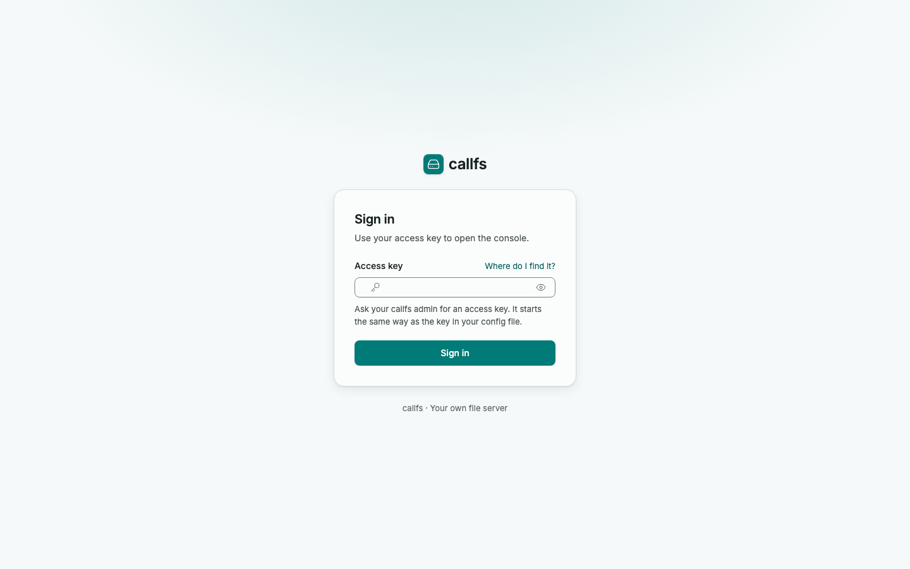

Open `/ui/login`. The page is titled "Sign in" and has one field.

- **Access key**: paste an API key from your config (`auth.api_keys`). Ask your CallFS admin if you do not have one. The "Where do I find it?" link explains where keys come from.
- **Show key / Hide key**: reveals or hides what you typed.
- **Sign in**: opens the console.

Errors you can see:

| Message | Meaning |
|---|---|
| That key did not work. Check it and try again. | The key is wrong. |
| Too many tries. Wait 1 minute. | The sign-in rate limit was hit. The limit is `server.rate_limit.session_rps` and `server.rate_limit.session_burst`. |
| We cannot reach the server. Check that callfs is running. | The browser could not connect. |

What happens after sign-in:

- The server sets a `callfs_session` cookie and the browser keeps a CSRF token that it sends on every change request. See [Authentication and Security](04-authentication-security.md).
- The sign-in lasts `ui.session_ttl` and ends after `ui.idle_timeout` with no use.
- About 2 minutes before a sign-in ends, a "Still there?" or "Your session ends soon." dialog appears with a countdown. Choose **Stay signed in** to extend it, or **Sign out**.
- If the session ends, a "You are signed out." dialog asks for your access key again. The console keeps your place and your open page. If you are sent to the sign-in page instead, it shows "Session expired. Sign in again to keep working. We kept your place." and takes you back to your page after you sign in.
- Sign out any time from the account menu (top right) with **Sign out**. Signing out ends the session on the server, so the old cookie stops working on every server in a cluster.

## The console layout

The console has four parts.

- **Sidebar** (left): three groups of pages, **Work**, **Operate** and **Configure**. Collapse it with the "Collapse sidebar" button or the `[` key. On a narrow screen the sidebar becomes a bottom bar with a **More** entry.
- **Top bar**: the breadcrumb ("You are here"), the "Search or jump to…" box (opens the command palette), the server picker when the cluster has more than one server, the live indicator, **Jobs** (with a badge showing running jobs), **Notifications**, **Help** and the **Account** menu.
- **Page area**: each page has a title, a one-line job description, and its actions on the right.
- **Dock** (bottom): transfers and the current selection. See [Transfers](#transfers).

Sidebar pages:

| Group | Page | Sub-pages |
|---|---|---|
| Work | Overview | |
| Work | Files | Files, Search files, Flat list, Transfers, Trash |
| Work | Sharing | |
| Operate | Cluster | Topology, Members, Replication, Servers, Storage, Durability, Backup copy, Hygiene, Edit locks, Index cache, Request limits |
| Operate | Insights | Dashboards, Explore, Storage, Metrics |
| Operate | Activity | Events, Audit log, Logs, Jobs, Sign-ins |
| Configure | Settings | Network, Limits and timeouts, Security, Storage, File index, Cluster and locks, Users and keys, Logging, Config file, About, Appearance, Shortcuts |

Account menu entries: your user name with an **Admin** badge if you are an admin, **Appearance**, **Shortcuts**, **Copy my user ID** and **Sign out**.

Banners at the top of every page tell you about conditions that need action:

- "Saved changes need a restart." with **Review changes**.
- "callfs cannot accept changes right now." when the cluster has no leader (reading still works), with **Open Topology**.
- "We cannot reach callfs." with **Try again**. The console retries by itself.
- "N critical findings need attention." with **Open Overview**.

The **Help** button opens a panel with the terms used on the current page (searchable), the shortcuts for the current page, and **Report a problem**. Report a problem copies the version, the current page and recent request IDs so you can send them to your admin ("Diagnostics copied.").

**Notifications** (`Ctrl+.` or `Cmd+.`) lists errors and important events. Filter by **All**, **Errors**, **Jobs** or **Cluster**. Each entry has **Open**, **Mark read**, **Copy request ID** and **Clear**. **Mark all read** clears the unread count.

## Roles and what each role sees

CallFS has two console roles.

- **Admin**: users listed in `auth.admin_users`. They see every page.
- **Member**: every other user. They see Overview, Files (Files, Search files, Transfers, Trash), Sharing, Activity > Jobs, and Settings > Appearance, Shortcuts and About.

Members only see their own files, links, jobs and transfers, and file actions follow the normal file permissions (see **Show permissions** on a file). Pages marked "Admin" below do not appear in a member's sidebar.

## Controlling any server in a cluster

When the cluster has more than one server, a server picker appears in the top bar. Its label reads "You control <server>. Pick a server to control." and its heading is "Control a server".

- Pick a server to send every console page and every change to that server. A strip on each page reads "Controlling <server>. Every change you make here goes to this server." with a **Back to <server>** button.
- Each entry shows the server name, **This server** for the server you signed in to, its role (Leader, Follower, Electing, Stopped, On its own), and its response time in ms. A server that does not answer shows **Not answering**.
- The same switch is available in Cluster > Servers (the **Control** button on a row) and in the command palette ("Switch to server <name>").
- After you switch you see "You now control <server>.". Going back shows "You are back on <server>.".
- The choice is remembered in your browser.

Behind the scenes the console sends the page's requests to `/v1/nodes/<server>/...`. See [Clustering](07-clustering.md) and the [admin API](10-admin-api.md).

## Command palette

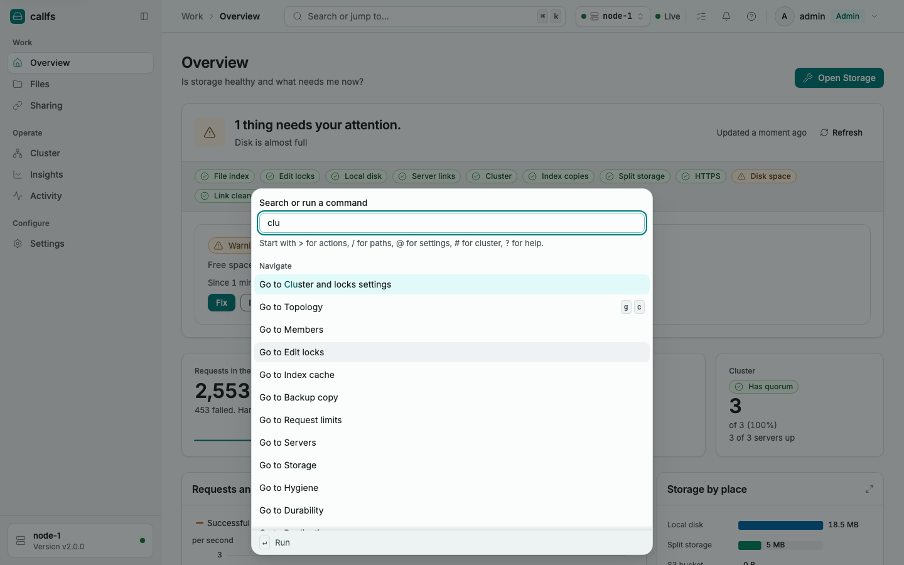

Open it with `Ctrl+K` (or `Cmd+K`), or click "Search or jump to…" in the top bar. The title is "Command palette" and the box reads "Name a command, file or setting".

Start the text with a character to narrow the search:

| Start with | Searches |
|---|---|
| `>` | Actions |
| `/` | Paths (file paths) |
| `@` | Settings |
| `#` | Cluster |
| `?` | Help |

The palette remembers the commands you ran last and lists them first (Recent), also after you reload. Results are grouped as Recent, Navigate, Files, Sharing, Cluster, Insights, Activity, Settings, Appearance, Help and Account. Press `Enter` to run the highlighted entry. For a path, `Tab` completes it. With an empty box the palette shows recent commands first.

The palette can:

- Go to any page ("Go to Overview", "Go to Files", "Go to Search files", "Go to Flat list", "Go to Transfers", "Go to Trash", "Go to Sharing", "Go to Topology", "Go to Members", "Go to Replication", "Go to Servers", "Go to Storage", "Go to Durability", "Go to Backup copy", "Go to Hygiene", "Go to Edit locks", "Go to Index cache", "Go to Request limits", "Go to Dashboards", "Go to Explore", "Go to Storage insights", "Go to Metrics catalog", "Go to Events", "Go to Audit", "Go to Logs", "Go to Jobs", "Go to Sign-ins", every Settings page, "Go to Wall" and "Go to Report").
- Open notifications and toggle the sidebar.
- Change appearance: system, light or dark theme; standard or more contrast; compact, default or comfortable density; full, reduced or no motion; small, default, large or extra large text; sharp, medium or round corners; **Open theme editor**; **Reset appearance**.
- Explain a term ("Explain <term>"), show keyboard shortcuts, and report a problem.
- Run page actions: "Add member", "Take snapshot", "Move leader", "Make leader", "Remove member", "Force release lock", "Clear index cache", "Clear cache under path", "Open job…", "Copy request ID", "Run explore query", "Add explore chart to dashboard".
- Switch to another server ("Switch to server <name>").
- Copy my user ID and sign out.

Admin-only commands only appear for admins.

## Keyboard shortcuts

Press `?` anywhere (outside a text field) to open "Keyboard shortcuts". The sheet has a "Find a shortcut" box. It also tells you whether single-key shortcuts are on or off.

`Mod` means `Ctrl` on Windows and Linux and `Cmd` on macOS. Shortcuts like `g` then `o` are two keys pressed one after the other within one second. Single-key shortcuts stop while you type in a field.

**Everywhere**

| Keys | Action |
|---|---|
| `Mod+K` | Open command palette |
| `/` | Focus search |
| `?` | Show keyboard shortcuts |
| `g` `o` | Go to Overview |
| `g` `f` | Go to Files |
| `g` `s` | Go to Sharing |
| `g` `c` | Go to Cluster |
| `g` `i` | Go to Insights |
| `g` `a` | Go to Activity |
| `g` `,` | Go to Settings |
| `g` `t` | Go to Transfers |
| `g` `j` | Go to Jobs |
| `g` `l` | Go to Logs |
| `[` | Hide or show the sidebar |
| `Mod+.` | Open notifications |
| `Mod+Shift+L` | Switch light and dark |
| `Esc` | Close or clear |

**Lists and tables**

| Keys | Action |
|---|---|
| `j` or Down | Next row |
| `k` or Up | Previous row |
| `Enter` or `o` | Open row |
| `x` or `Space` | Select row |
| `Shift+J` / `Shift+K` | Extend selection down / up |
| `Mod+A` | Select all |
| `Shift+F10` or the context-menu key | Open row menu |
| `r` | Refresh (data pages) |
| `e` | Export table |

**Files**

| Keys | Action |
|---|---|
| `Backspace` or `Alt+Up` | Up one folder |
| `Space` | Quick preview |
| `i` | Show or hide inspector |
| `F2` | Rename |
| `m` | Move to |
| `d` | Download |
| `Shift+D` | Download range |
| `l` | Create download link |
| `c` | Copy path |
| `Mod+X` / `Mod+V` | Cut / Paste |
| `Delete` | Move to trash |
| `Shift+Delete` | Delete for good |
| `u` | Upload files |
| `Shift+U` | Upload folder |
| `n` | New folder |
| `.` | Show or hide hidden files |
| `v` | Switch list and grid |
| `Mod+L` | Edit path |

**Other**

| Keys | Action |
|---|---|
| `t` | Toggle live tail (Logs) |
| Left / Right | Move the crosshair on a chart (`Home` and `End` jump to the first and last point) |
| `Mod+S` | Save settings |

### Change a shortcut

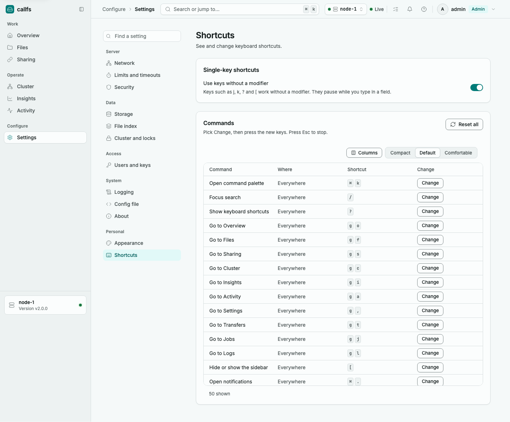

Go to Settings > Shortcuts (any role). The page is titled "Shortcuts": "See and change keyboard shortcuts."

- **Single-key shortcuts**: the switch "Use keys without a modifier". Keys such as `j`, `k`, `?` and `[` work without a modifier. Turn it off if they clash with your browser or screen reader.
- The **Commands** table has the columns Command, Where, Shortcut and Change. "Where" is Everywhere, Lists, Data pages, Tables, Files, Logs and events, Charts or Settings.
- **Change**: press the new keys. `Esc` cancels. If the keys are used by another command you see "Already used by <command>. Press other keys, or Esc to cancel."
- **Reset all**: restores the defaults ("Shortcuts reset to defaults.").

## Themes and appearance

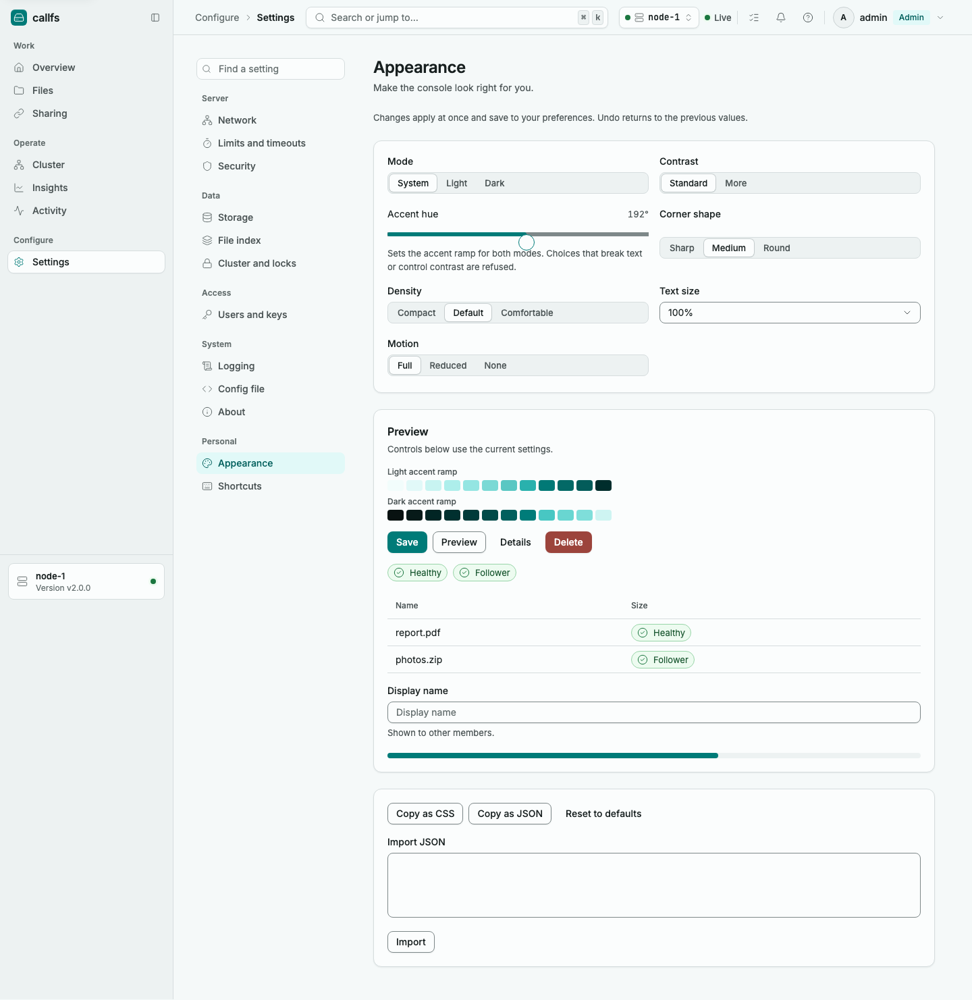

Go to Settings > Appearance (any role), or use the account menu. Changes apply at once and save to your preferences. **Undo** returns to the previous values.

| Control | Choices |
|---|---|
| Mode | System, Light, Dark |
| Contrast | Standard, More |
| Accent hue | A slider in degrees. A hue that would drop text or control contrast below the minimum (4.5:1 for text, 3:1 for the focus ring) is refused with "This accent cannot be used", and the previous accent stays. |
| Corner shape | Sharp, Medium, Round |
| Density | Compact, Default, Comfortable |
| Text size | A percent scale (small, default, large, extra large from the palette) |
| Motion | Full, Reduced, None |

A **Preview** panel shows sample buttons, a meter, a field and a table with your settings, plus the light and dark accent ramps.

Also on the page:

- **Export**: **Copy as CSS** or **Copy as JSON**.
- **Import JSON** with **Import**: paste a theme. Invalid JSON shows "This is not a valid theme file. Check the JSON and try again."
- **Reset to defaults**.

Switch between light and dark at any time with `Mod+Shift+L`. The Overview in dark mode:


Your preferences (theme, density, shortcuts, table choices and similar) are saved per user on the CallFS server, so they follow you to another browser.

## Live updates

Pages refresh themselves. You do not need to reload. Notification toasts stay on screen while your pointer or keyboard focus is on them and count down again when you leave. Charts work with the keyboard: focus a chart, then use Left and Right to move the crosshair and `Home` and `End` to jump to the ends.

- Cluster pages refresh every 5 seconds. Overview, Jobs, Transfers, Events and Logs update as things happen.
- The **live indicator** in the top bar and on pages shows **Live**, **Stale**, **Reconnecting**, **Offline** or **Paused**. Click the refresh control next to it to reload now.
- When the browser tab is hidden for 60 seconds, updates pause (**Paused**). They resume when you come back.
- When your computer goes offline, the indicator turns **Offline** and the console reconnects when the network returns.
- Press `r` on a data page to refresh it.
- Insights and Activity pages have a **Live** toggle next to the time range ("Turn on live updates" / "Stop live updates").
- Events has **Pause** and **Resume**, and counts new events while paused ("N new").
- Logs has **Live tail** (`t`).

## Tables, search syntax and exports

Most lists share the same controls.

- **Sort**: click a column header.
- **Columns**: choose which columns show and their order. **Reset columns** restores the default.
- **Row density**: Compact, Default, Comfortable.
- **Resize** a column by dragging its edge.
- **Select**: use the row checkbox. "Select all on this page" selects a page, and "Select all N matching" selects every match. **Clear selection** clears it. A bar of bulk actions appears when rows are selected.
- **Pages**: First, Previous, Next, Last and Rows per page. Some lists use **Load more**.
- **Export**: **Export CSV** or **Export JSON** (`e`). A CSV cell that starts with `=`, `+`, `-` or `@` gets a leading apostrophe so a spreadsheet does not run it as a formula.
- **Row menu**: right-click, `Shift+F10`, or the **Actions** button.

Search boxes on Files > Search files, Activity > Audit log and Activity > Logs use `field:value` filters. Filters combine with spaces. Hold `Alt` and click a suggested value to exclude it. Bad parts are underlined with a reason (unknown field, empty value, bad size, bad date, bad status, bad range or unclosed quote).

| Field | Where | Meaning | Examples |
|---|---|---|---|
| `name` | Files | Name pattern | `name:*.log` |
| `type` | Files | `file` or `directory` | `type:file` |
| `size` | Files | Number and unit; `>`, `<` or `..` range | `size:>100MB`, `size:1MB..1GB` |
| `modified` | Files | Span or date | `modified:<7d`, `modified:>2026-01-01` |
| `owner` | Files | User that owns the file | `owner:alice` |
| `storage` | Files | Where the file is kept | `storage:s3`, `storage:localfs` |
| `server` | Files | A CallFS server name | `server:node-1` |
| `split` | Files | `yes` or `no` | `split:yes` |
| `locked` | Files | `yes` or `no` | `locked:yes` |
| `user` | Audit | User that made the change | `user:alice` |
| `op` | Audit | Action name | `op:delete` |
| `path` | Audit | Text inside the full path | `path:/team` |
| `status` | Audit | HTTP status 100 to 599 | `status:>=400` |
| `level` | Logs | `debug`, `info`, `warn`, `error` | `level:error` |

## Overview

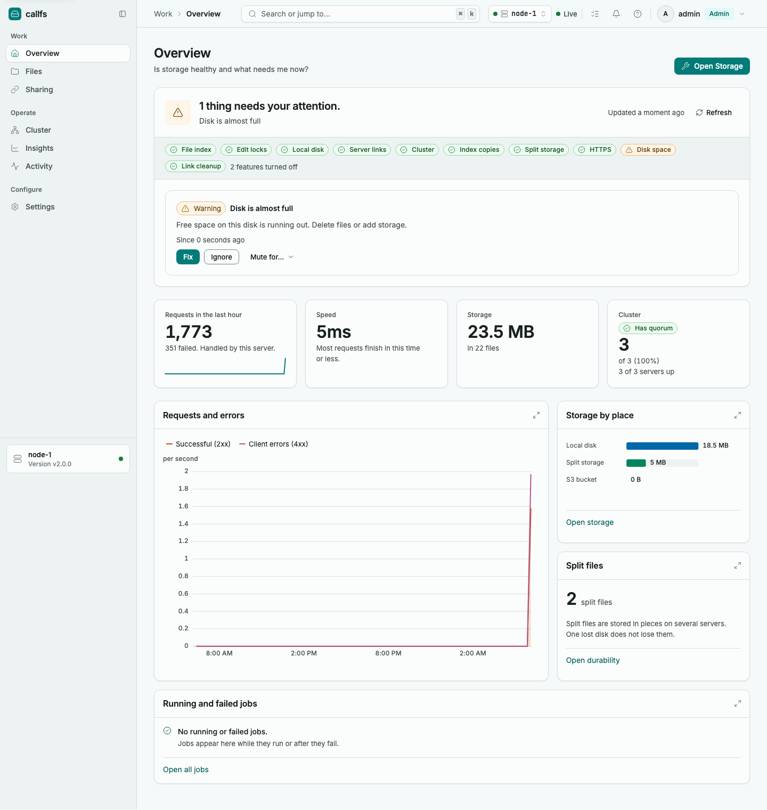

Where: Work > Overview (`/ui/`, or `g` `o`). All roles. Job: "Is storage healthy and what needs me now?"

For admins the page shows:

- **Verdict banner**: "All systems working.", "N things need your attention.", "callfs cannot accept changes right now." or "Some checks are not available." with the cause underneath.
- **Health checks**: one tile for each of File index, Edit locks, Local disk, S3 bucket, Server links, Cluster, Index copies, Split storage, HTTPS, Disk space, Copies and Link cleanup. A tile shows Healthy, Needs attention, Down or Off. A count shows how many features are turned off.
- **Findings** (admin only): the list of problems and risks CallFS found. See [Findings](#findings-fixing-muting-and-ignoring). The primary button becomes **Fix** for the top finding, or **Upload files** when there are none.
- **Key numbers**: Requests (with change against the previous hour and last day), Speed (the time most requests finish in), Storage (bytes and file count) and Cluster ("Single server" or "N of M servers up").
- **Charts**: "Requests and errors" split by Successful (2xx), Redirected (3xx), Client errors (4xx) and Server errors (5xx), and "Split files" with a link to **Open durability**.
- **Running and failed jobs** with **Open all jobs**.
- **Storage by place**: Local disk, S3 bucket and Split storage bytes, with **Open storage**.
- **Setup checklist**: "Use safe connections (HTTPS)", "Replace default secrets", "Give each key its own user", "Add an admin user", "Keep metrics private", "Protect the index link (sslmode)" and "Back up the file index". Each links to the right setting. **Dismiss checklist** hides it.
- "No files yet. Upload a file to start." appears on an empty server.

For members the page shows "Your files are safe." with My files (count and size stored), My active links, My running jobs, Recent files and "My links expiring today".

Dark theme is the same page with the dark palette (see [Themes](#themes-and-appearance)).

## Files

### Files (browse)


Where: Work > Files (`/ui/files/`, or `g` `f`). All roles. Job: browse, preview and manage files.

Layout: a **Folders** tree (toggle with **Show folder tree** / **Hide folder tree**), the file list, and an inspector panel on the right.

Top of the page:

- **Breadcrumbs** ("Folder path"), starting at **All files**. `Mod+L` turns the path into an editable box.
- **Upload** menu: **Files…** (`u`) and **Folder…** (`Shift+U`). You can also drag files and whole folders from your computer onto the page. The page shows "Drop files or folders here to upload". A dropped folder keeps its structure, and files already there go through the [conflict choices](#transfers).
- **New folder** (`n`).
- **Filter this folder**: a box ("Filter by name") that filters the current folder. If nothing matches, **Clear filter** or **Search everywhere** appears.
- **View**: **List** or **Grid** (`v`). **Show hidden** (`.`) shows names that start with a dot.
- **More actions**: **Calculate folder size** and **Export list**.

List columns (choose and order them with **Columns**): Select, Name, Size, Modified, Owner, Storage, Server, Version tag, Mode, Split, Backup, Locked. Split shows "Split storage" or "Single copy". Locked shows "Locked" or "Not locked". Backup (admins, when backup copy is on) shows "Backup copy" for a file that has its second copy and "Backup copy failed" for a file whose copy failed.

**Context menu**: right-click a row (or long-press on a touch screen, or press `Shift+F10`) to open the row actions below. Right-click empty space in the list for folder actions: **New folder** (`n`), **Paste here** (`Mod+V`, greyed out with "Nothing was cut." when nothing is cut), **Calculate folder size**, **Export list** and **Copy path** for the folder.

Row actions (right-click or the row menu):

| Action | What it does |
|---|---|
| Open | Opens a folder, or previews a file. |
| Download | Downloads the file. With several selected: "Download N items". |
| Download range… | Downloads a byte range of a file ("From byte", "To byte"). Ranges over 2 GB download the whole file. |
| Create download link… | Makes a single-use link (see [Sharing](#new-download-link)). Files only. |
| Copy path / Copy URL | Copies the path or the full URL. |
| Rename | Renames in place (`F2`). |
| Move to… | Opens the destination picker (below). Several items: "Move N to…". |
| Cut | Marks the item (or all selected items) to move (`Mod+X`). Open another folder and choose **Paste here** (`Mod+V`). |
| Change mode… | Permission boxes (Owner, Group, Others by Read, Write, Run), an octal number such as `644`, or letters such as `u=rw,go=r` or `rwxr-xr-x`. Wrong input shows "Enter three or four digits from 0 to 7." or "Use letters like u=rw,go=r or rwxr-xr-x." |
| Change owner… | Admins only. Gives the file to another user ID. Only the owner changes. |
| Show permissions | Shows whether you can Read, Change and Delete this path, with the reason (you own it, admins can do it, the folder is open, only the owner can). |
| Verify pieces / Repair pieces | For split files. |
| Show history | Opens the Activity tab in the inspector. |
| Move to trash | Moves to Trash (`Delete`). |
| Delete for good… | Permanent (`Shift+Delete`). The dialog first counts the files, folders and bytes that will go ("This deletes N files and N folders (size). This cannot be undone."). Download links to the file stop working. When more than 100 files or more than 1 GiB will go, you must type `DELETE` to confirm. |

The "other" read and write bits of the mode decide what other users can do: read lets them open the file or list the folder, write lets them change the file or create items in the folder. Deleting stays with the owner. Owners and admins are not limited by the mode. New folders start at `0777` and new files at `0644`.

**Move to… dialog**: Destination path, with Recent and Pinned places and **Browse folders**. Admins can also choose Storage (**Keep current storage**, Local disk, S3 bucket) and Server (**Keep current server** or another online server) to move the file to another storage or server. Options: **Overwrite existing files** (keep off unless you mean it) and **Create missing folders**. A preview line says what will move. Moves across storage or servers run as a job ("The move runs as a job. Follow it in Jobs."). Folders can move only within the same storage and server.

**Cut and paste**: select items, press `Mod+X` (a toast says "Cut N items. Open a folder and paste."), open the destination folder and press `Mod+V`. Items that are already in that folder are skipped ("Those items are already in this folder."). Pasting never overwrites.

**Preview** (`Space`): shows text (with Find in file, Wrap lines, Follow new lines and **Pretty JSON**), images (Fit, 100%, zoom), video, audio, PDF, and a hex view (Go to offset, for example `4096` or `0x1000`). Other types show "No preview for this file type". Buttons: Previous file, Next file, Open in new tab, Download, Download range, Copy path, Full screen.

**Inspector** (`i`): the **Pin inspector** button keeps it open. Tabs:

| Tab | Content |
|---|---|
| Details | Path, Type, Size (and exact bytes), Modified, Created, Changed, Accessed, Owner, Mode, Version tag, Storage, Server, Split storage, Link target. |
| Placement | Storage, Server, Route (This server, Another server, Legacy location), Edit lock (who holds it, since when, expiry), Index cache (Served from cache or Read from storage). Admin. |
| Durability | For split files: **Verify pieces**, **Repair pieces**, "N of M pieces OK". |
| Links | Download links for this file with **Create download link**, each Active, Used, Expired or Revoked. |
| Permissions | The Read, Change and Delete check. |
| Activity | What happened to this file: Uploaded, Replaced, Renamed, Moved, Deleted for good, Moved to trash, Restored, Opened, Listed, Created a download link, Opened a download link. Admin. |

Empty states: "This folder is empty. Drop files here, press U to upload, or N for a new folder.", "You cannot open this folder." (no access), "This folder does not exist anymore." with **Go to parent folder**, and "Some items could not be listed." with **Try again**.

Select several rows to see a bulk bar with Download, Move, Move to trash and Delete for good. After **Move to trash** a toast offers **Undo**.

### Search files

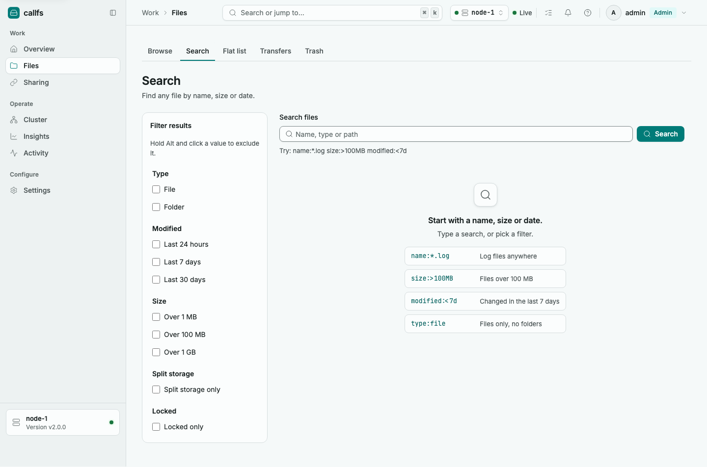

Where: Files > Search files (`/ui/files/search`). All roles. Job: "Find any file by name, size or date."

- Type a query using the [search fields](#tables-search-syntax-and-exports), or press a **Example searches** chip: "Log files anywhere", "Files over 100 MB", "Changed in the last 7 days", "Files only, no folders".
- **Filters** (with a count) opens the facets: Type (File, Folder), Storage, Owner, Server, Modified (Last 24 hours, Last 7 days, Last 30 days), Size (Over 1 MB, Over 100 MB, Over 1 GB), Split storage (Split storage only) and Locked (Locked only).
- **Save search** keeps the query (disabled with a reason when empty or already saved).
- Results columns: Path, Size, Modified, Owner, Storage, Version tag. The count shows "N files in X seconds". Over 5,000 matches shows "More than 5,000 files. Narrow your search." Use **Load more** for further results.
- Empty result: "No files match '<query>'." with **Clear filters**.

### Flat list

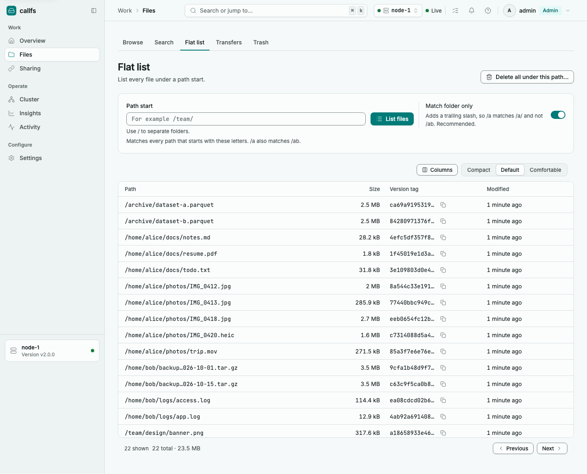

Where: Files > Flat list (`/ui/files/flat`). Admin. Job: "List every file under a path start."

- **Path start**: matches every path that starts with these letters, so `/a` also matches `/ab`.
- **Match folder only** (recommended): adds a trailing slash so `/a` matches `/a/` and not `/ab`.
- **List files** runs it. The footer shows "N total" and bytes.
- **Delete all under this path…** deletes everything the list matches. The dialog shows how many objects and bytes will go, and how many are outside your access and will stay. Type `DELETE` and confirm with **Delete N objects**.
- "You cannot list one or more files here." means the list is all or nothing; ask an admin to widen access.

### Transfers


Where: Files > Transfers (`/ui/files/transfers`, or `g` `t`). All roles. Job: "See and control uploads and downloads."

The **dock** at the bottom of every page shows a **Transfers** tray ("N active · P%") with tabs **Active**, **Queued**, **Failed**, **Done**. The full page has the tabs **Active**, **Waiting**, **Failed**, **Done** and **Server**.

- Columns: Name, Destination, Progress, Speed, Time left, State.
- Row actions: **Pause**, **Resume**, **Cancel**, **Retry**, **Open folder**, **Upload diagnostics**. Page actions: **Retry failed**, **Clear finished**.
- **Server** (admin) lists every user's transfers with User, Kind, Path, Started and Client.
- **Upload diagnostics** shows Part size, Parallel parts, Parts done, Resumed at and Last error.
- States: Waiting, Uploading, Downloading, Paused, Stalled (no data for 15 seconds), Checking, Done, Failed, Cancelled, Needs a choice.
- **Checking** (verifying) runs after an upload of up to 64 MiB: the console compares the SHA-256 of your local file with the ETag the server returned and marks the transfer Failed if they differ.
- **Unfinished uploads**: an interrupted resumable upload stays on the list, also after you reload the page. Choose **Pick file** and select the same file to carry on where it stopped, or **Discard**. A file of a different size is refused ("That is not the same file. The size is different."), and an upload that ran out of time must be started again.

**Transfer settings**:

| Setting | Default | Range |
|---|---|---|
| Parallel uploads | 3 | 1 to 6 |
| Part size | 8 MiB | 1 to 64 MiB |
| Conflict default | per your choice | Skip, Replace, Keep both, Replace if changed |

**Uploading from the console**

- Use **Upload > Files…** or **Folder…**, press `u` or `Shift+U`, or drag files and folders onto a folder.
- Files over 10 GB cannot be uploaded from the console ("Files over 10 GB cannot be uploaded here."). Use the [upload API](03-api-reference.md) for larger files.
- Files of 64 MiB or more are sent in parts. If the connection drops, the upload resumes where it stopped ("Resumed at <size>"), even after a page reload.
- When a name already exists, "N files are already here" shows a table ("Already there", "New file", Action) with the existing and new size and date and an action for each file, or one policy for all ("If a file already exists"). Confirm with **Upload N files** or **Cancel upload**. A transfer that waits for your answer shows "Needs a choice".

| Policy | Result |
|---|---|
| Skip | Keep the file that is there. |
| Replace | Replace the file that is there. |
| Keep both | Save the new file with a new name. |
| Replace if changed | Replace only when the size or date differs. |

**Downloading from the console**

- **Download** on a file starts a browser download. Several items download together.
- **Download range…** saves a byte range ("Saved bytes A to B of <name>").
- Download links for other people: see [Sharing](#sharing).

### Trash

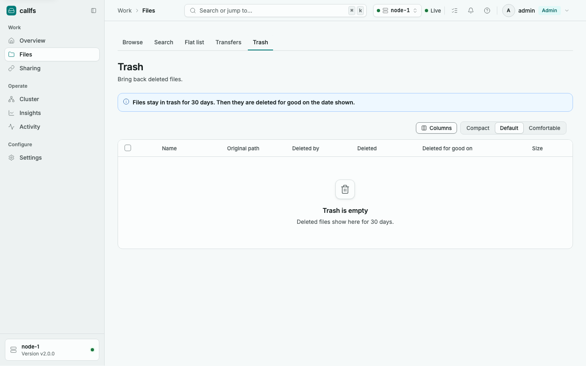

Where: Files > Trash (`/ui/files/trash`). All roles. Job: "Bring back deleted files."

"Files stay in trash for 30 days. Then they are deleted for good on the date shown." The period is `trash.retention`; see [Storage](05-storage.md).

- Columns: Name, Original path, Deleted by, Deleted, Deleted for good on, Size.
- **Restore** (or "Restore N files") puts files back. If a file with the same name exists, the "Some files are there" dialog asks what to do with each file, or one choice for all: **Replace**, **Keep both** (adds " (restored)" to the name), **Replace if changed** (replaces only when the size or date differs) or **Skip** (leaves the file in trash). A toast reports "Restored N files." and "Left N files in the trash.".
- **Delete for good** (or "Delete N files for good") is permanent and asks you to confirm.
- **Empty trash** deletes everything in trash for good (it runs in the background and shows as a job).
- Select files first. Without a selection you see "Select files to restore first."

## Sharing


Where: Work > Sharing (`/ui/sharing`, or `g` `s`). All roles. Job: "See and control every download link." Members see their own links. Admins see every link.

A download link is a single-use link to one file. Opening it uses it up, even if the download fails. Anyone with the link can download. It expires on its own.

Admins also see counts at the top: **Active links**, **Used today**, **Failed opens last 24h** (with Expired, not found and invalid counts), and a **Clean up old links now** button. The page tells you when cleanup last ran ("Last cleanup <when>: cut N expired and N used.").

- Tabs: **Active**, **Used**, **Expired**, **Revoked**, **All**.
- Columns: File, Status, Created by, Created, Expires, Used, Used from, Link ID.
- Row actions: **Show details**, **Open file**, **Copy file path**, **Revoke**. Only active links can be revoked. Select several rows to revoke them together ("Revoke N links").

### New download link

Click **New download link** (or **Create download link** from a file, or `l` in Files).

- **File path**: the full path, for example `/team/report.pdf`. **Check file** confirms it exists. Folders are refused ("Links work for files only.").
- **Link expires after**: 15 minutes, 1 hour, 1 day or Custom time.
- A box lists what to know before you create it: works once, anyone with the link can download, the expiry date, and opening it uses it up.
- **Create link** shows the **Link**, a copy button and **Copy as curl**, and an "Expires in" countdown.

The same link works from the command line:

```bash
curl -O "https://files.example.com:8443/download/<token>"
```

See [API Reference](03-api-reference.md) for creating links with the API.

### Link detail

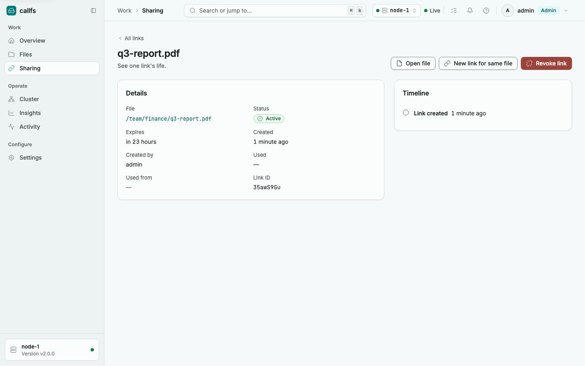

Where: Sharing > a link row > **Show details** (`/ui/sharing/<link-id>`). Job: "See one link's life."

- **Details**: the file, who created the link, when, when it expires, when and from where it was used.
- **Timeline**: Link created, Used to download, Expired or Revoked, and each open attempt: "Opened and downloaded", "Opened after it ran out", "Opened with a wrong link", "Opened, but the file was not found" with the source address.
- Buttons: **Open file**, **New link for same file**, **Revoke link**, **All links** (back).
- A link ID that does not exist shows "This link does not exist."

## Cluster

All Cluster pages are for admins. They work for the server you are controlling (see [server picker](#controlling-any-server-in-a-cluster)). Group headings in the section menu are Members, Data and Runtime. For how the cluster works, see [Clustering](07-clustering.md).

### Topology


Where: Operate > Cluster > Topology (`/ui/cluster`, or `g` `c`). Job: "See every server and member at a glance."

- Key numbers: **Members up** (with how many members the cluster has), **Log entries** and **Servers reachable**. On a server that runs alone: Servers reachable, Files stored, Bytes stored.
- **Cluster map**: each server and member as a node, with the leader named above it. **Color by** State, Response time, Behind (log lag) or Disk free. Click a node (**Open**) to see it. The map works with the keyboard too.
- **Quorum**: how many members can fail before the file index stops taking changes.
- A table of **Servers and members**: Name, Role (Member or Server), State, Server address, Last seen, Behind, Actions.
- Buttons: **Add member** (clusters), **Add server address** (single servers with other addresses).
- A server that runs alone shows "This server runs alone." with the steps to turn on clustering (turn it on in file index settings, start each new server with the same cluster secret, add each server as a member) and a link **Open index settings**.
- "Some servers did not answer." means their numbers may be old; refresh.

### Members


Where: Cluster > Members (`/ui/cluster/nodes`). Job: "See who is in the cluster, add a member or remove one that is offline."

- A table of **Cluster members**: Member, State (**Leader**, **Follower** or **Unreachable**), Online (Yes or No), Last seen, Behind by (how many file index changes the member has not applied yet) and Server address. A server that runs alone shows "This server runs alone." with **How to add members**.
- Row menu: **Make leader** (online members that are not the leader) and **Remove member** (offline members only; never the server you are on). A toast confirms "Leadership moved to <member>." or "<member> was removed.".

**Add member** opens a form with three fields and creates the config for the new server. Nothing changes in the cluster until you start the new server.

| Field | Rule | Example |
|---|---|---|
| Member ID | Letters, numbers and dashes, starting with a letter or number. Must not be used by another member. | `callfs-node-4` |
| Server address | The web address of the new server, starting with `https://` or `http://`. | `https://node-4.example.com:8443` |
| Cluster address | Host and port the other members use to reach the new server. | `10.0.0.14:6222` |

Choose **Create config**. The panel shows the config file to save on the new server ("Config for <member>", with a copy button), a **Next steps** list, and the API request that creates the same config (`GET /v1/admin/cluster/join-config`, see the [admin API](10-admin-api.md)). **Edit details** goes back to the fields and **Done** closes the panel. The same form opens from Topology > **Add member**, the command palette ("Add member") and `/ui/cluster/nodes?add=member`.

**Remove member** asks "Remove <member> from the cluster?" and shows how the member count changes ("Members go from N to N-1"), that its copies of the file index move to the other servers, and that the removed server stops getting file index changes. A member that is online or is the server you are on cannot be removed ("It is online or it is this server. Stop it first, then remove it.").

Raft cluster mode was removed in 2.0.0; configs that use it are rejected at startup. Use `metadata_store.type: nats` and `dlm.type: nats`.

### Member detail

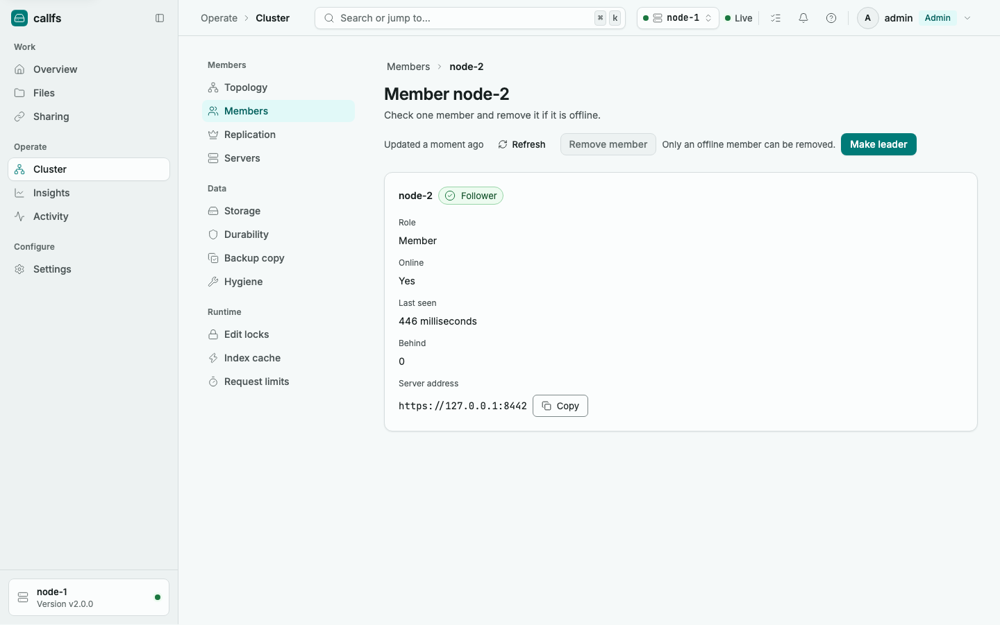

Where: Cluster > Members > a member (`/ui/cluster/nodes/<id>`). Job: "Check one member and remove it if needed."

Shows that member's state, whether it is online, its server address, when it was last seen and how far behind it is. **Make leader** moves leadership here (disabled with "An offline member cannot lead." for an offline member). **Remove member** removes an offline member (for any other member the page says "Only an offline member can be removed."). A member that is not in the cluster shows "<id> is not in this cluster." with **All members**.

### Replication


Where: Cluster > Replication (`/ui/cluster/replication`). Only shown when clustering with NATS is on. Job: "Check the file index log, its copies and snapshots."

- **File index log**: Leader, Messages, Size, First sequence, Last sequence, Applied on this server, Last snapshot ("Sequence N, <time>" or "None yet") and Keeps up to (how many snapshots are kept).
- **Stored state**: Files, Folders (not counting the top one), Active, Used, Expired and Revoked links, Split files and Index entries.
- **Copies**: one row for each server holding a copy of the file index: Server, Up to date, Behind by and Last seen.
- **Snapshots**: ID, Sequence, Size and Created. A snapshot saves the file index so a new member catches up fast. The server also takes snapshots by itself (see `nats.metadata.snapshot_interval` and `nats.metadata.snapshot_every` in [Configuration](02-configuration.md)).
- **Take snapshot** saves one now ("Snapshot saved at sequence N."). **Move leader** opens "Move the leader": pick the member that should lead, or **Automatic** to let the cluster choose, then **Move leader**.
- **Show technical details** hides or shows the sequence numbers, stored state and snapshots, leaving the leader, message count and copies.
- **Settings**: "The file index is kept on N servers." with **Open index settings**.
- A server that runs alone shows "Replication is off on this server." with **Open index settings**.

### Servers

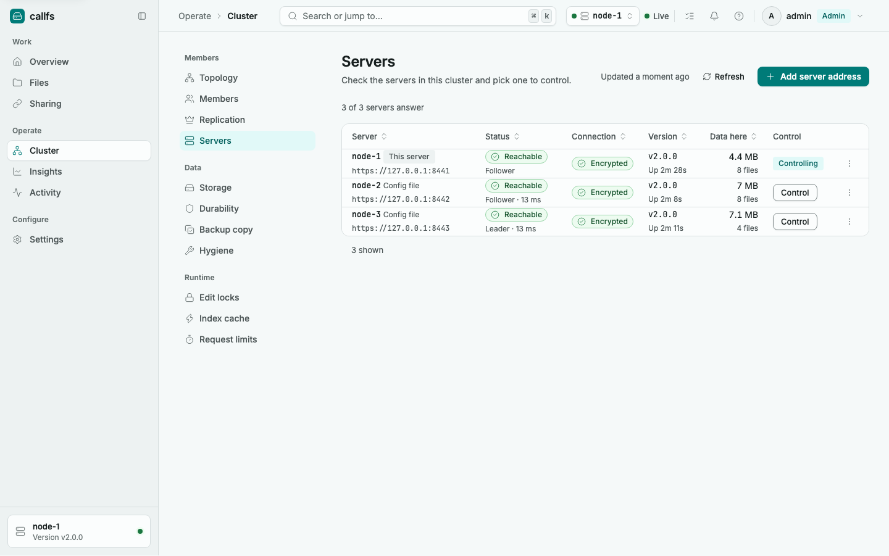

Where: Cluster > Servers (`/ui/cluster/servers`). Job: "Check servers that hold files."

- Columns: Server (ID, web address, a **This server** badge or the source: Config file or Joined), Status (with the reason when a server is down), Connection (HTTPS or not), Version (with uptime), Data here (bytes and file count), Disk free (free bytes with "of <total>", shown when the table is wide enough), Pieces (when split storage is used) and Control. Narrow screens hide the less important columns. A summary reads "N of M servers answer".
- **Add server address** (Server ID plus a web address such as `https://node-2.example.com:8443`; use `https://` so traffic between servers is encrypted).
- Row actions: **Check now**, **Change address**, **Remove address**, **Control** (switch the console to this server; the server you control shows **Controlling**). Removing an address means files on that server cannot be reached from here until you add it again.
- "A server cannot be reached. Its files are not available until it returns."
- This is where server addresses (`instance_discovery.peer_endpoints`) are managed from the console.

### Storage

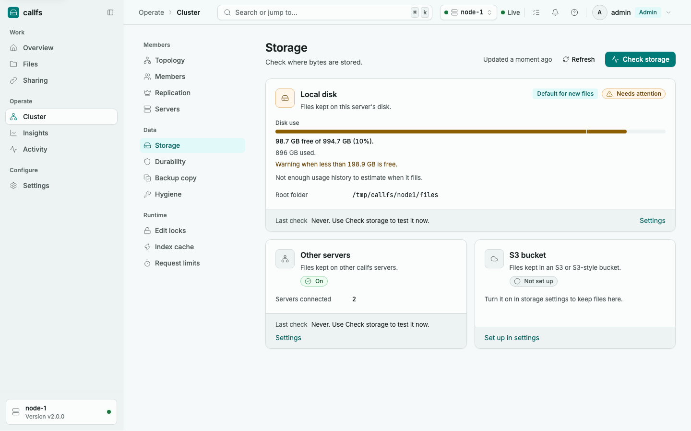

Where: Cluster > Storage (`/ui/cluster/storage`). Job: "Check where bytes are stored."

A card for each storage: **Local disk**, **S3 bucket** and **Other servers**. The default for new files is marked **Default for new files**.

- Local disk: Root folder, disk use meter with a warning level, and when it will fill ("Full in about N days", "Full in less than a day.").
- S3 bucket: Bucket, Region, Endpoint, Encryption, Access setting, Encryption key set. A bucket that allows public reads warns "Anyone with the link can read files in this bucket."
- **Check storage** writes, reads and deletes a test file and shows the times. The card shows "Last check".
- A storage that is off shows "Not set up" with **Set up in settings**.

### Durability

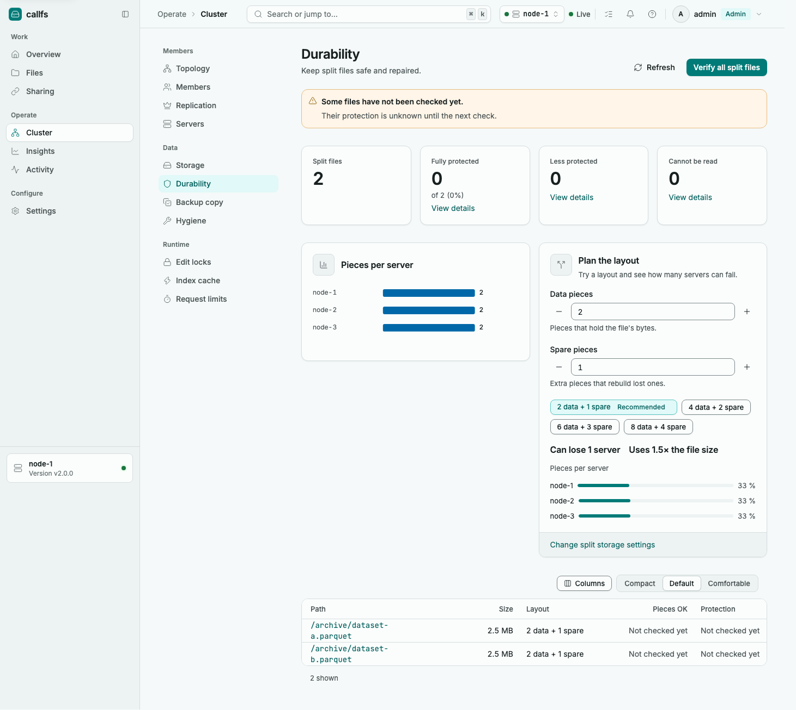

Where: Cluster > Durability (`/ui/cluster/durability`). Job: "Keep split files safe and repaired." See [Storage](05-storage.md) for split (erasure-coded) storage.

- Key numbers: Split files, Fully protected, Less protected, Cannot be read. Chart: **Pieces per server**.
- Table of split files: Path, Size, Layout ("4 data + 2 spare"), Pieces OK, Protection, Last checked.
- Buttons: **Verify all split files**, **Repair damaged files**, **Refresh**.
- **Plan the layout** lets you try a number of Data pieces and Spare pieces (with presets, one marked Recommended) and see how many servers you can lose, the space used ("Uses 1.5× the file size") and pieces per server. **Change split storage settings** opens Settings > Storage.
- When split storage is off: "Split storage is off." with **Open storage settings**.
- Click a file to open its detail page (`/ui/cluster/durability/file/<path>`): **Verify pieces**, **Repair pieces**, a **Piece map**, a **Pieces** table (Piece, Kind Data or Spare, Server, Storage, Size, Check sum, State OK, Missing, Damaged, Server unreachable, Repaired, with a download button for each piece) and the **Manifest** JSON.

### Backup copy

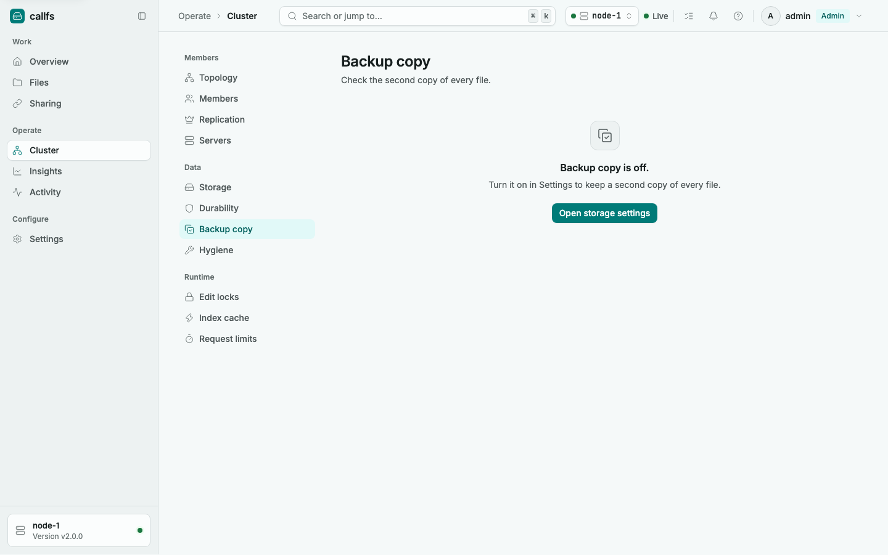

Where: Cluster > Backup copy (`/ui/cluster/backup`). Job: "Check the second copy of every file."

- The mode: **Off**, **Required** (an upload fails when its backup copy fails) or **Best effort** (uploads still succeed; failed copies are listed). The target storage is shown ("Copies go to <storage>").
- Key numbers: **Copies made (24h)**, **Failed (24h)**, **Waiting for retry**.
- A **Failed copies** table: Path, Error, When, with a **Retry** button per row and **Retry failed copies** for all.
- When off: "Backup copy is off." with **Open storage settings**.

### Hygiene

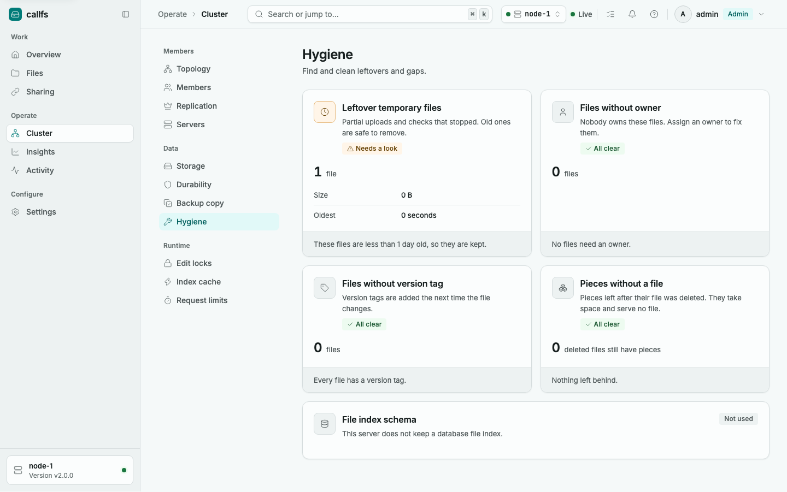

Where: Cluster > Hygiene (`/ui/cluster/hygiene`). Job: "Find and clean leftovers and gaps."

| Section | What it shows | Action |
|---|---|---|
| Leftover temporary files | Partial uploads and stopped checks (Files, Size, Oldest). | **Clean up older than 1 day** removes files older than 1 day. Your files are not touched. |
| Files without owner | Files nobody owns. | **Assign owner…**: every file with no owner gets the user ID you type. |
| Files without version tag | Files that have no version tag. | **Add version tags**. |
| Pieces without a file | Pieces left after their file was deleted (Pieces, Split records). | Information. |
| File index schema | Version and available updates. | Shows "Update stuck" if an update did not finish. |

Each action runs as a job.

### Edit locks

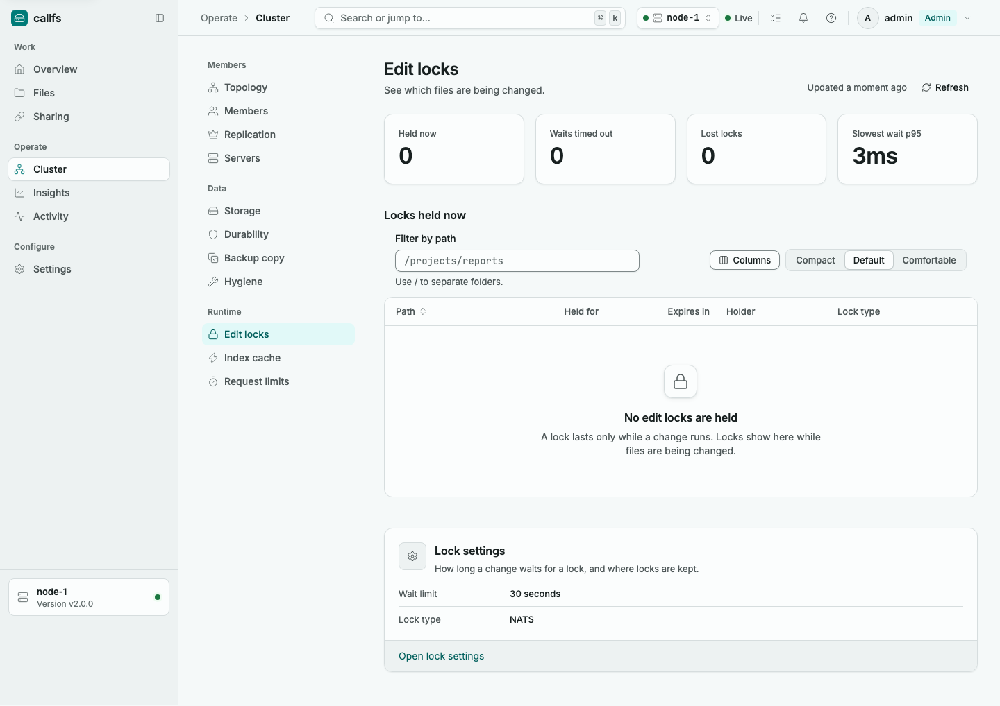

Where: Cluster > Edit locks (`/ui/cluster/locks`). Job: "See which files are being changed."

- Key numbers: **Held now**, **Waits timed out**, **Lost locks**, **Slowest wait p95** (lock waits are measured for every lock type: Local, Redis and NATS).
- **Filter by path**. Table: Path, Held for, Expires in, Holder, Lock type.
- **Force release…** opens a confirm dialog: give a **Reason** (it goes into the audit log) and type `RELEASE`. The change in progress may fail or leave the file half written.
- A lock only lasts while a change runs. "Lock settings" shows the wait limit and lock type with **Open lock settings**.

### Index cache

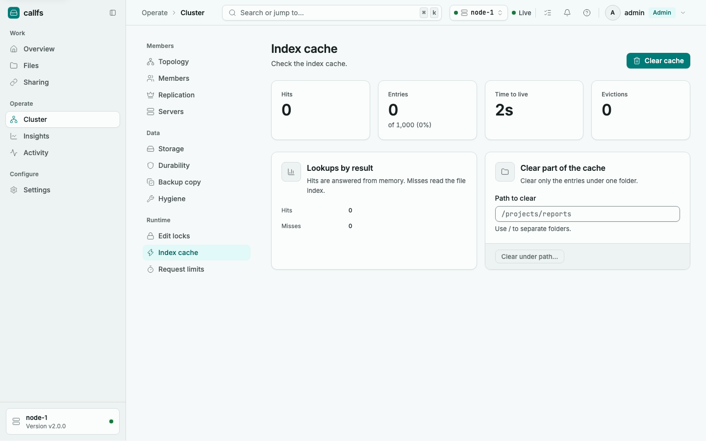

Where: Cluster > Index cache (`/ui/cluster/cache`). Job: "Check the index cache."

- Key numbers: Hits, Entries, Time to live, Evictions. Chart: **Lookups by result** (Hits, Misses).
- **Clear cache** clears everything ("Clear all" in the confirm). **Clear under path…** clears only the entries under one folder.
- When off: "The index cache is off on this server." with **Open index settings**. The cache is controlled by `server.metadata_cache_ttl`.

### Request limits

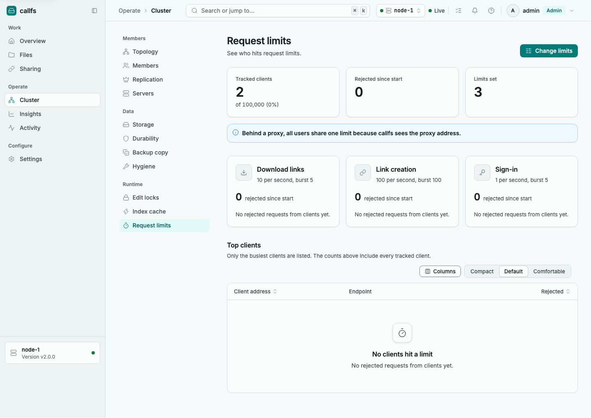

Where: Cluster > Request limits (`/ui/cluster/limits`). Job: "See who hits request limits."

- One card per limited endpoint: **Download links**, **Link creation** (default 100 per second, burst 100), **Sign-in**, each with its rate ("N per second, burst M") and **Rejected since start**. In a cluster the limits are shared by all servers when `nats.counters` is on.
- **Rejections by client** and **Top clients** (Client address, Endpoint, Rejected). Behind a proxy, all users share one limit because CallFS sees the proxy address.
- **Change limits** opens Settings > Limits and timeouts.

## Insights

All Insights pages are for admins. Pages with charts have a time range bar: **15m**, **1h**, **6h**, **24h**, **7d**, **Custom**, plus a **Live** toggle. Panel buttons: **Show data** (inspect), **Full screen**, **Retry**.

### Dashboards


Where: Operate > Insights > Dashboards (`/ui/insights`, or `g` `i`). Job: "See traffic, speed, errors and growth."

Tabs: **Traffic**, **File work**, **Download links**, **Edit locks**, **File index**, **Errors**, **Custom**. Panels include requests per second by status, server errors, top and slowest routes, response time by route and a heatmap, file and storage actions, uploads and downloads in progress, links created and opened, active locks and lock waits, index queries and cache hits, and errors by part, route and sign-in failures. Panels with a warning or critical level show the threshold.

- **Refresh all** reloads every panel.
- **Edit layout** lets you move panels earlier or later, hide or show them. **Done editing** saves. Hidden panels are listed under "Hidden panels".
- **Custom** holds charts you saved from Explore. It is empty until you add one ("Save a chart from Explore to pin it here.").

### Explore

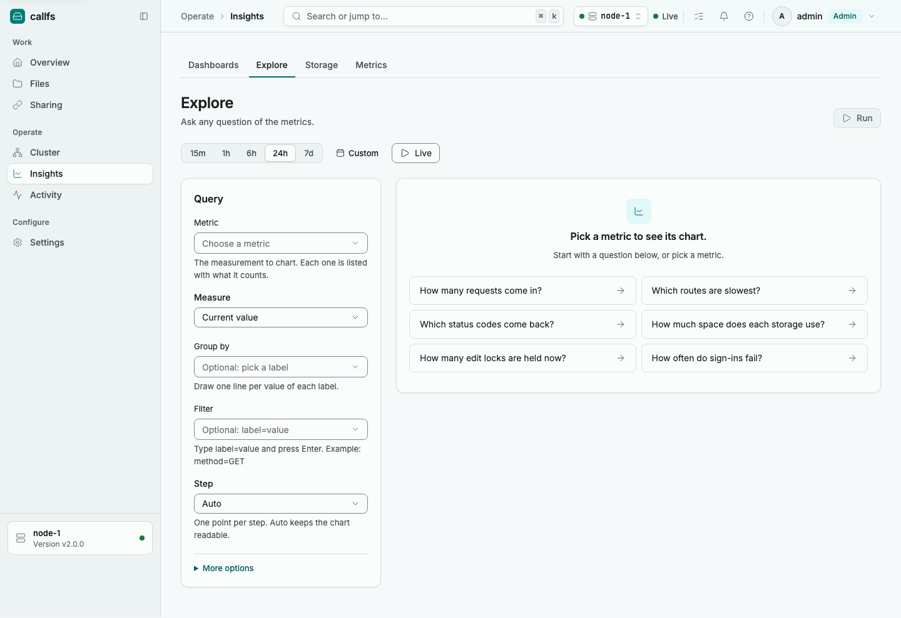

Where: Insights > Explore (`/ui/insights/explore`). Job: "Ask any question of the metrics."

| Control | Choices |
|---|---|
| Metric | Any metric from the catalog. |
| Measure | Rate per second, Total, Average, Median (p50), 95th percentile (p95), 99th percentile (p99), Highest, Current value |
| Group by | Draw one line per value of the chosen labels. |
| Filter | Type `label=value` and press Enter, for example `method=GET`. |
| Time range | 15m, 1h, 6h, 24h, 7d, Custom |
| Step | Auto, 10 seconds, 1 minute, 5 minutes, 1 hour |
| Chart type | Line, Stacked, Bars, Table, Heatmap (needs a histogram metric) |
| Compare with previous period | Draws the earlier period for comparison. |
| Show as x of y | Divides one series by another. |

Click **Run** (or press the run command). Starter questions help when the page is empty: "How many requests come in?", "Which routes are slowest?", "Which status codes come back?", "How much space does each storage use?", "How many edit locks are held now?", "How often do sign-ins fail?".

Share and save: **Copy link**, **Copy as PromQL**, **Add to dashboard** (line, stacked and bar charts only).

### Storage insights

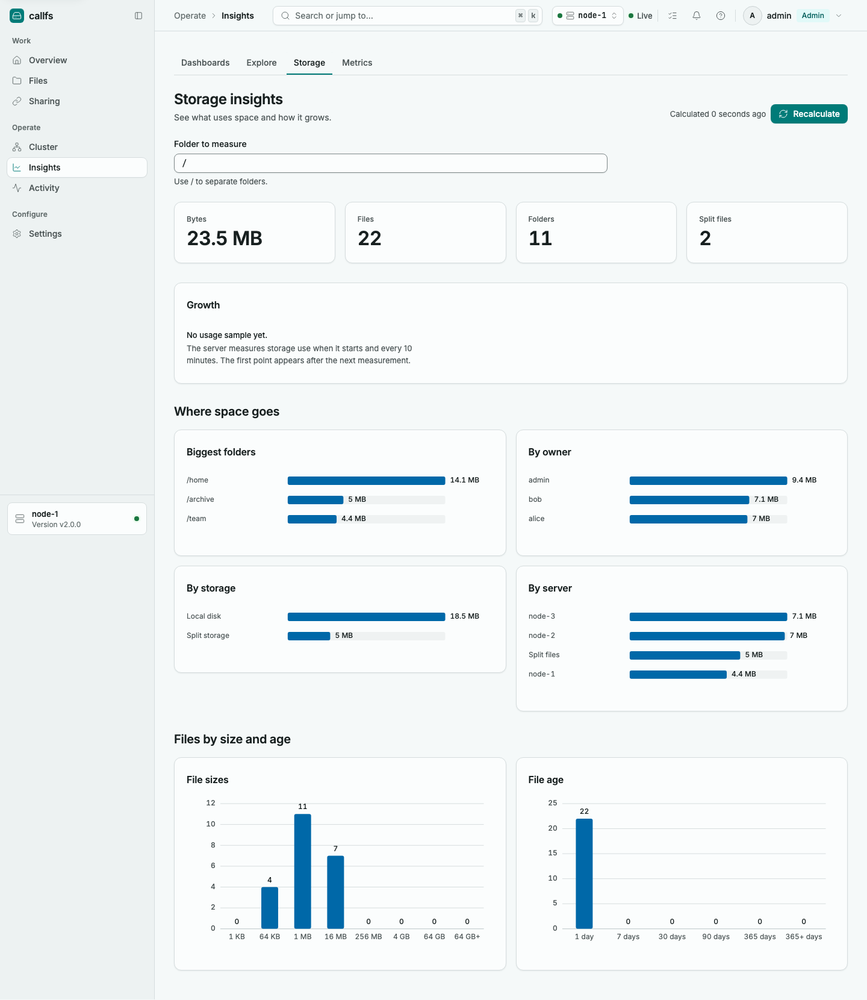

Where: Insights > Storage (`/ui/insights/storage`). Job: "See what uses space and how it grows."

- **Folder to measure**: counts that folder and everything in it. **Recalculate** starts a count job.
- Key numbers: Bytes, Files, Folders, Split files.
- **Growth** chart, **Biggest folders**, **By storage** (Local disk, S3 bucket, Split storage, Other server), **By server**, **By owner**, **File sizes** and **File age**. Each has **Show table**.
- The server measures usage when it starts and every 10 minutes.
- "The count is still running." links to **Open job**.

### Metrics catalog


Where: Insights > Metrics (`/ui/insights/metrics`). Job: "See every metric and what it means."

- Table: Name, Type, Labels, Plain meaning, Since start (Has data or None since start), Current value, and an **Explore** link per metric.
- **Find a metric** and a filter: **All**, **Has data**, **None since start**.
- **Where to scrape**: the **Main endpoint** (needs an access key) and the **Metrics port** (separate port, no access key; keep it on a private network). A warning says "The metrics port has no sign-in."
- See [Monitoring and Metrics](06-monitoring-metrics.md) for every metric name.

## Activity

### Events


Where: Operate > Activity > Events (`/ui/activity`, or `g` `a`). Admin. Job: "See what happened, live."

- Filter by event type: **Files**, **Links**, **Cluster**, **Config**, **Jobs**, **Health**, **Security**.
- Time range bar with **Live**; **Pause** and **Resume** the stream ("N new" counts events that arrived while paused).
- Shows the newest events only if there are many ("Showing the newest N events only.").

### Audit log


Where: Activity > Audit log (`/ui/activity/audit`). Admin. Job: "See who did what to which file."

- Search with `user:`, `op:`, `path:`, `status:` (for example `user:alice op:delete path:/team status:403`).
- Columns: Time, User, Action, Path, Result (Done or Failed), Duration, Server, Request ID.
- Actions: Opened, Listed, Checked, Uploaded, Replaced, Renamed, Moved, Deleted, Moved to trash, Restored, Created link, Opened link, Signed in, Admin change, Other action.
- Click a row for **Action details**: When, User, Action, Path, Method, Route, Result, Uploaded and Downloaded bytes, Duration, Server, Client address, Request ID and **Linked logs** for the same request. **Copy request ID** copies the ID.
- **Export CSV** and **Export JSON**.
- Members get "Only admins can see the audit log."

### Jobs


Where: Activity > Jobs (`/ui/activity/jobs`, `g` `j`, or the **Jobs** button in the top bar). All roles. Members see their own jobs. Job: "Watch long work and fix failures."

Jobs are long tasks such as deleting a folder, moving across storage, repairing pieces, changing owners, emptying trash and cleanup. Kinds shown: Delete folder contents, Delete folder, Batch change, Repair pieces, Check all split files, Retry backup copies, Change owner, Clean up staging, Measure usage, Empty trash, Clean up old links, Refresh version tags.

- Tabs: **Running**, **Failed**, **Done**, **Background**.
- **Background** (admin) lists the background workers: Clean up old links, Empty old trash, Clean up half-done uploads, Check servers, Sample metrics, Measure usage. Columns: Worker, Every, Last run, Result (Finished, Failed, Not run yet), Next run, Action (**Run now**).
- **Background** (admin) also shows a "Failed background tasks" section: tasks that ran out of retries, with Pool, Reason, Failed at and Summary. **Retry** puts the task back in the same server queue it came from; **Drop** removes it. The list is empty when NATS is off.
- Click a job for its detail page (`/ui/activity/jobs/<id>`): Kind, State (Waiting, Running, Done, Done with errors, Failed, Cancelled, Stopping), Progress, Speed, Time left, Started, Duration, Started by, Target, and a **Failed items** table (Path, Reason, Code).
- Buttons: **Cancel job** (asks "Stop this job?"; work already done stays), **Retry failed items**, **Copy report**, **All jobs**.
- Finished jobs are removed after a while ("This job is gone.").

### Logs


Where: Activity > Logs (`/ui/activity/logs`, or `g` `l`). Admin. Job: "Read server logs."

- Search box ("Search logs"), level filters **Errors**, **Warnings**, **Info**, **Debug**, and **Live tail** (`t`).
- **Load older lines** and "N new. Jump to latest."
- Click a line for Time, Logger, Request ID and **Copy JSON**.
- "Log level is <level>." with **Change it**, which opens Settings > Logging.
- The console keeps `ui.log_buffer_entries` lines.

### Sign-ins


Where: Activity > Sign-ins (`/ui/activity/sign-ins`). Admin. Job: "See failed sign-ins and key use."

- Key numbers: **Wrong keys, 24 hours**, **Client addresses**, **Users active, 24 hours**.
- **Failed sign-ins**: Time, Client address, Reason (Missing key, Wrong key, Expired session, Security check failed), Path.
- **Key use**: for each user, the Key, Last sign-in and Failed sign-ins in 24 hours.

## Settings

Where: Configure > Settings. `/ui/settings` opens Network for admins and Appearance for members.

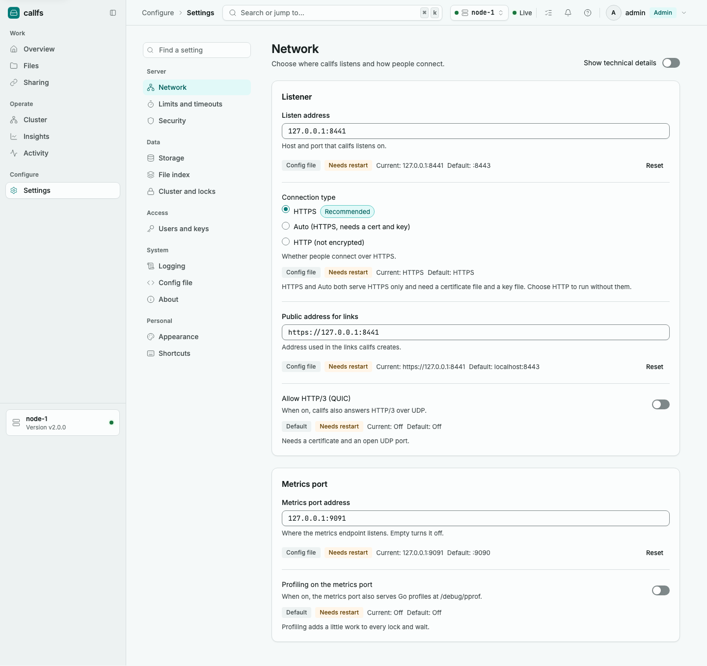

The settings menu has five groups:

| Group | Pages |
|---|---|
| Server | Network, Limits and timeouts, Security |
| Data | Storage, File index, Cluster and locks |
| Access | Users and keys |
| System | Logging, Config file, About |
| Personal | Appearance, Shortcuts |

A search box ("Find a setting") filters the settings menu. Members see About, Appearance and Shortcuts only.

### Editing settings


Network, Limits and timeouts, Storage, File index, Cluster and locks, and Logging are editable groups. The page title tells the job, for example "Choose where files live and how they are kept safe."

Each setting row shows its plain-language label, what it does, and a badge:

- **Applies now**: the change takes effect immediately, no restart.
- **Needs restart**: the change is saved but only used after a restart.
- A source marker: Default, Config file, Environment or Changed while running.
- A row set by an environment variable is locked: "Set by environment variable <NAME>. Change it where the server starts."

How saving works:

- Sections made only of "Applies now" settings **autosave**. A toast says "Saved" or "Applied now." and offers **Undo**.
- Sections with "Needs restart" settings collect your edits. Use **Review and save** (`Mod+S`) to open a review panel. It validates the change ("Checks passed. Nothing is saved yet."), lists each change as "Changed from X to Y", says how many need a restart, and shows the same change as an API request. **Save N changes** writes the config file. **Discard** drops the edits.
- Some risky changes ask you to type a word first ("This change affects every user. Type the word shown to confirm.").
- Values that fail validation are listed at the top ("N values need fixing") with links to each row. Fix them and review again.
- Risky values show a warning, for example plain `http`, a listener open to every address, a debug log level, a public S3 ACL, or default secrets.
- **Reset** returns a row to its default.
- **Show technical details** (top right) shows each setting's config key and environment variable with copy buttons.
- Some sections offer **presets**: Timeouts (Standard, Large files, Strict), Default storage (Local disk only, S3 bucket, S3 with local backup copy) and Logs (Production, Troubleshooting). A preset sets several values at once; "Custom" appears when your values match none.
- A text list setting has **Add item**, **Remove** and **Move up/down**. A map setting has **Add entry**. Secret settings show Set or Not set with **Replace**, **Show**, **Generate**, **Copy secret** and a length meter (use 32 characters or more).

**What needs a restart**: any setting with the "Needs restart" badge. Settings that apply live include the request limits, `server.metadata_cache_ttl`, `dlm.wait_timeout`, `ui.session_ttl`, `ui.idle_timeout`, `trash.enabled`, `trash.retention` and `log.level`. [Configuration](02-configuration.md) lists "restart needed" for every key.

**Restart**: after you save a restart-needed change, a banner reads "N saved changes need a restart" with **Restart now** (shown when `ui.allow_remote_restart` is `true`). The restart takes a few seconds ("Restarting callfs. The console reconnects when it is back."). Without remote restart, restart the service yourself, for example `systemctl restart callfs` or `docker restart callfs`.

Sections per page:

| Page | Sections |
|---|---|
| Network | Listener, Metrics port |
| Limits and timeouts | Timeouts, Index cache, Edit locks, Request limits, Console sessions (session length and idle timeout) |
| Storage | Default storage (includes performance mode), Local disk (write acknowledgement, sync mode, true overwrite, the **Limit file size** switch and temp save size, flush workers), S3 bucket, Split storage (including the smallest file size that is split and the folder for pieces), Backup copy, Trash |
| File index | Engine (Postgres, SQLite, Redis or NATS), Postgres, SQLite, Redis, NATS: file index log, NATS: file index snapshots |
| Cluster and locks | This server, Other servers, NATS: this node, NATS: network, NATS: encryption and sign-in, NATS: disk and memory, NATS: external servers, NATS: edit locks, NATS: events, logs and tasks, NATS: transfers and counters, Edit locks |
| Logging | Logs, Console history (includes `ui.enabled`, `ui.allow_remote_restart` and the console buffers) |

On Storage, Local disk has two overwrite rows. **True overwrite** (`backend.localfs_true_overwrite`, needs restart, off by default): off is faster, on makes every overwrite wait at any size. **Temp save up to** (`backend.localfs_tmp_save_max_size`, needs restart): files up to this size use the temp save and bigger files use a true overwrite. It sits behind a **Limit file size** switch and shows "No limit" when the switch is off. Turning the switch off removes the key from the config file. The row is hidden while true overwrite is on. The smallest limit is 1 byte. See [Storage](05-storage.md#overwrites).

The Security page (Certificate, Server-to-server, Secrets, Log privacy) holds `backend.internal_proxy_ca_file`, an extra certificate authority used to check other servers' HTTPS certificates.

#### Cluster and locks


This page holds every `nats.*` setting and the edit lock settings. Each row shows its plain-language label, effect and default, and whether it applies now or needs a restart. See [Clustering](07-clustering.md) and [Configuration](02-configuration.md) for what every key does.

| Section | What you set |
|---|---|
| This server | The server ID (`instance_discovery.instance_id`). |
| Other servers | Addresses of the other servers (`instance_discovery.peer_endpoints`). |
| NATS: this node | Turn the cluster service on (`nats.enabled`), `nats.mode` (embedded or external), server and cluster names, `nats.server_tags`. |
| NATS: network | Client and cluster listen addresses, `nats.routes`, `nats.routes_from_peers`, `nats.monitor_listen`. |
| NATS: encryption and sign-in | `nats.tls.*` (certificate, key, CA, client certificate and key; mutual verification when a CA file is set), `nats.auth.mode` (`derived`, `nkey` or `creds`; `creds` only with an external server), key and creds files, `nats.auth.previous_secret` for a rolling secret change. |
| NATS: disk and memory | `nats.jetstream.*`: storage folder, memory and disk limits, sync mode, `unique_tag`. |
| NATS: external servers | `nats.external.urls`, `js_domain`, `tls_ca_file` to connect to your own NATS servers. |
| NATS: edit locks | `nats.locks.replicas`, `ttl`, `queue_stale` (fair first-come lock queue). |
| NATS: events, logs and tasks | `nats.streams.*`: copies, how long events, audit and dead-letter entries are kept, `logs_level` (logs at or above it are shared so the Logs page shows every server), `tasks_max_deliver` and `tasks_backoff` for background copy tasks. |
| NATS: transfers and counters | `nats.rpc_timeout`, `nats.bytes` (`http` or `chunked`), `nats.counters` (cluster-wide request limits and upload slots). |
| Edit locks | Lock type `dlm.type` (`redis`, `local` or `nats`) and the Redis address and password for `redis` locks. |

The File index page holds `nats.metadata.*`: copies, apply timeout, read and miss barriers, maximum message size, `snapshot_interval`, `snapshot_every`, `retain_commands` and `retain_snapshots`.

### Users and keys

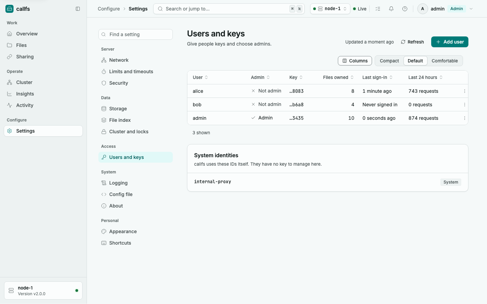

Where: Settings > Users and keys (`/ui/settings/access`). Admin. Job: "Give people keys and choose admins." Users are application users; they are not operating-system users.

- Table: User, Admin, Key, Files owned, Last sign-in, Requests (24h), Failed sign-ins. A summary shows the last 24 hours.
- **Add user**: User ID (letters and numbers; this ID owns the files the user uploads; `root` and `internal-proxy` are reserved) and an **Admin** switch. CallFS shows the new key once; copy it and press **Done**.
- Row menu: **Make admin** or **Remove admin**, **Replace key** (the old key stops at once), **Transfer files** (give files in a folder to another user, `/` for every file; it runs as a job), **Remove user** (their files keep that owner; they cannot sign in).
- "Some keys share a numbered user" offers **Fix this** to give each key its own user ID.
- "Some files have no owner" links to Hygiene.
- Changes to users apply without a restart.

### Security

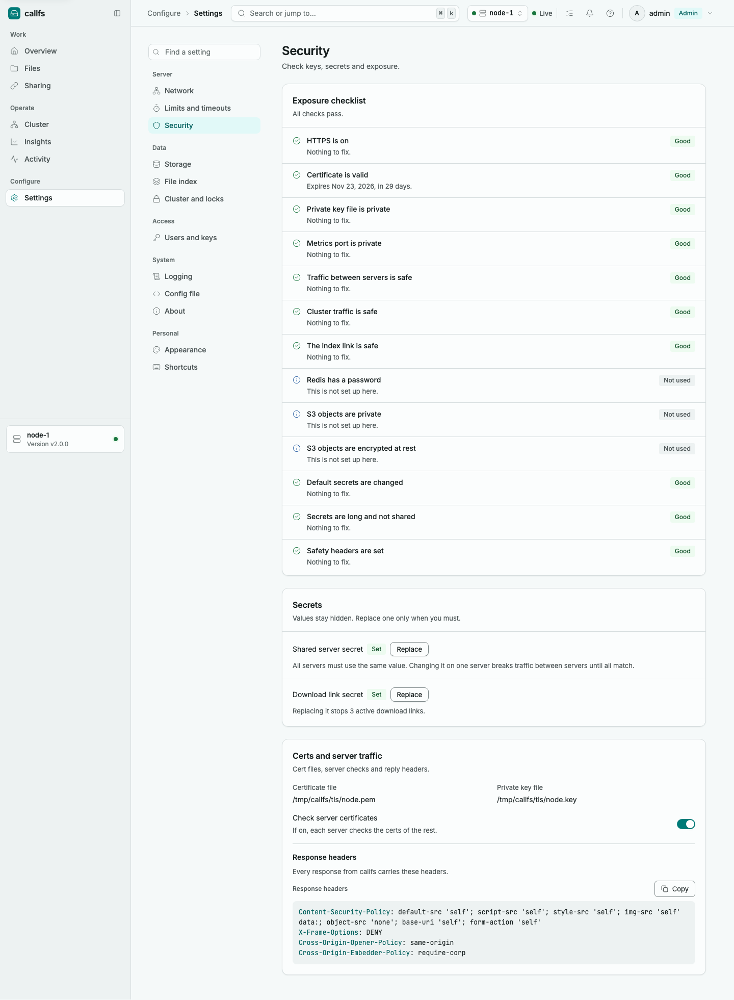

Where: Settings > Security (`/ui/settings/security`). Admin. Job: "Check keys, secrets and exposure."

- **Exposure checklist**: HTTPS is on, Certificate is valid, Private key file is private, Metrics port is private, Traffic between servers is safe, Cluster traffic is safe, The index link is safe, Redis has a password, S3 objects are private, S3 objects are encrypted at rest, Default secrets are changed, Secrets are long and not shared, Safety headers are set. Each shows Good, Fix soon, Fix now or Note, with a **Fix** link. **Fix top issue** jumps to the worst one.
- **Secrets**: "Shared server secret" (all servers must use the same value) and "Download link secret" (replacing it stops active download links). Type at least 16 characters, choose **Review replacement**, type `REPLACE` and confirm with **Replace secret**. Secrets stay hidden.
- **Certs and server traffic**: Certificate file, Private key file (a warning if it is readable by everyone), and **Check server certificates** (turning it off asks for confirmation).
- **Response headers**: the headers every response carries.

### Config file

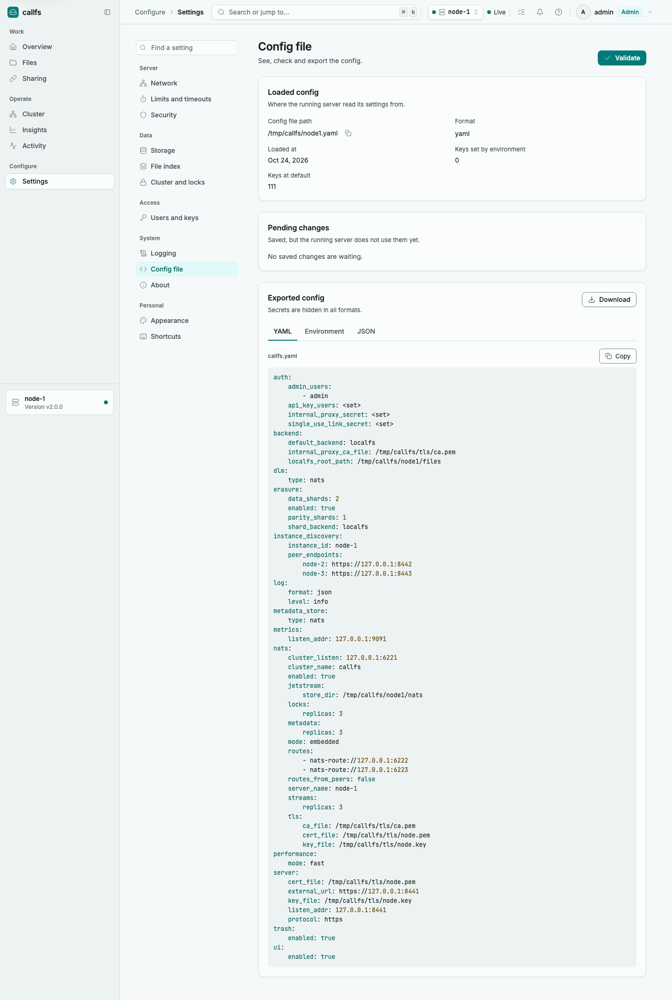

Where: Settings > Config file (`/ui/settings/file`). Admin. Job: "See, check and export the config."

- Loaded config: Config file path, Format, Loaded at, Keys set by environment, Keys at default.
- **Validate** checks the saved config ("Config is valid." or the first failing value).
- **Exported config** in **YAML**, **Environment** or **JSON**, with **Download**. Secrets are hidden in all formats.
- **Pending changes**: saved settings the running server does not use yet.
- **Restart server** (when `ui.allow_remote_restart` is `true`): confirm "Restart callfs now?". Clients lose their connection for a few seconds.

### About

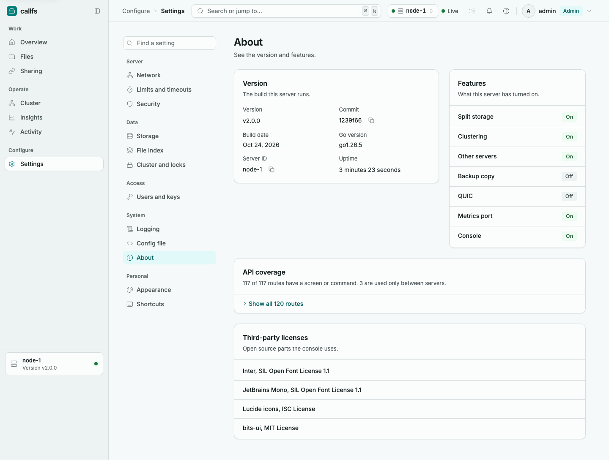

Where: Settings > About (`/ui/settings/about`). All roles. Job: "See the version and features."

- **Version**: Version, Commit, Build date, Go version, Server ID, Uptime.
- **Features** (On or Off): Split storage, Other servers, Backup copy, QUIC, Metrics port, Console.
- **API coverage**: every API route and the screen or command that covers it.
- **Third-party licenses**: Inter, JetBrains Mono, Lucide icons and bits-ui.

### Appearance and Shortcuts

See [Themes and appearance](#themes-and-appearance) and [Change a shortcut](#change-a-shortcut).

## Printable report and wall display

### Printable report

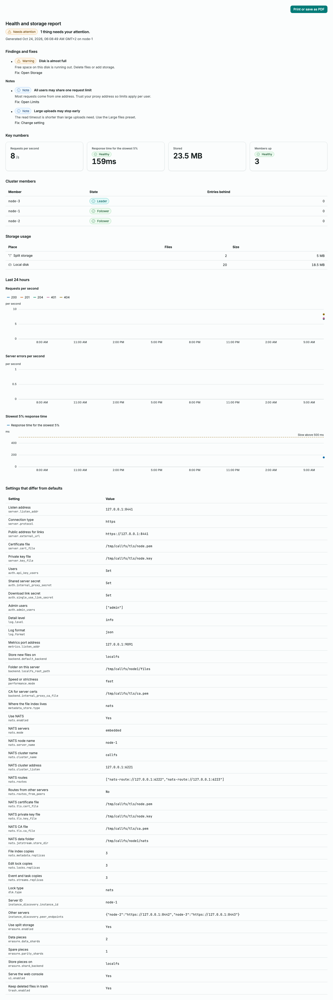

Where: `/ui/report`, or "Go to Report" in the command palette. Admin. The page is titled "Health and storage report". **Print or save as PDF** opens the browser print dialog; the page is laid out for A4 or Letter paper.

Sections: Findings and fixes ("No open findings." when clean, with a Fix line for each), Key numbers, Cluster members (Member, State, Entries behind), Storage usage (Place, Files, Size), Last 24 hours (Requests, Server errors, Response time for the slowest 5%, with the "Slow above 500 ms" mark), and "Settings that differ from defaults". The footer says "Generated <date> on <server>".

### Wall display

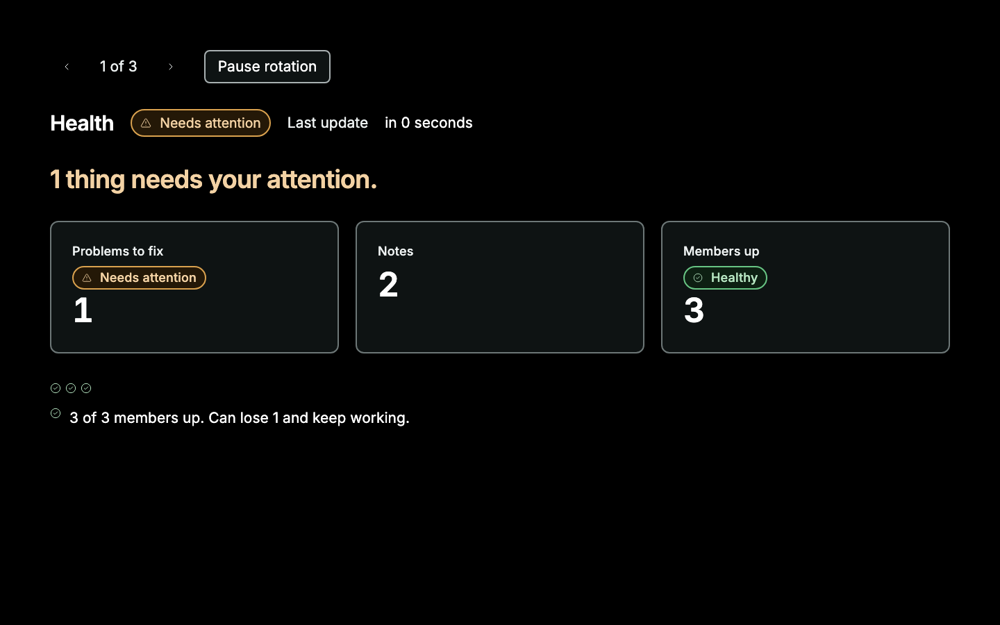

Where: `/ui/wall`, or "Go to Wall" in the command palette. Admin. A full-screen view for a monitor on the wall, with no menus and large type.

- Three boards rotate every 20 seconds: **Health** (verdict, Problems to fix, Notes, Members up; "N notes for your information." and, when something is down, "Check <component>. It reports down."), **Traffic** (Requests per second, Server errors per second, Response time for the slowest 5%) and **Storage** (Stored, Files, Split files, Growth in the last 24 hours).
- Use the Left and Right arrow keys, or **Previous board** and **Next board**. **Pause rotation** holds the current board. The position reads "1 of 3".
- "Last update" shows when data was fetched. If it is older than 30 seconds the wall says "Data is N seconds old".

## Findings: fixing, muting and ignoring

Findings are problems and risks CallFS finds in its own settings and state, for example HTTPS off, default secrets, no admin user, keys that share a numbered user, a failing storage or a file index update that did not finish. Admins see them in the **Findings** region on Overview, and in the printable report. Each shows a severity (**Critical**, **Warning** or **Note**), what it affects, and since when. See [Monitoring and Metrics](06-monitoring-metrics.md) for the full list.

For each finding you can:

| Action | What it does |
|---|---|
| **Fix** | Opens the page or setting that resolves it. |
| **Mute for…** | Hides it for **1 hour**, **1 day** or **7 days**. It comes back after that. **Unmute** brings it back at once. "Show N muted findings" lists them with who muted them and until when. |
| **Ignore** | Stops it counting toward health, banners and alerts on every server. You are asked for a reason ("Why ignore it?", for example "Internal network only"), then **Ignore finding**. |
| **Stop ignoring** | Starts counting it again. "Show N ignored findings" lists the ignored ones with who ignored them and the reason. |

Only the top findings are shown at first. **View all N findings** shows the rest and **Show fewer findings** collapses the list. When nothing needs attention you see "Nothing needs attention".

Related: [Troubleshooting](09-troubleshooting.md).
